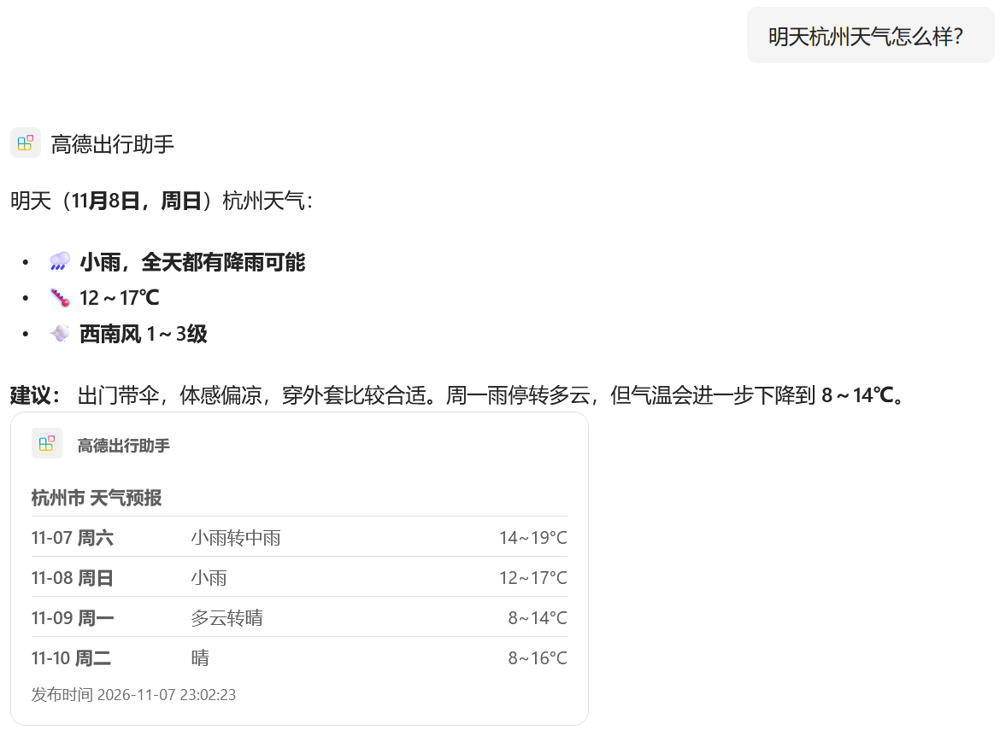
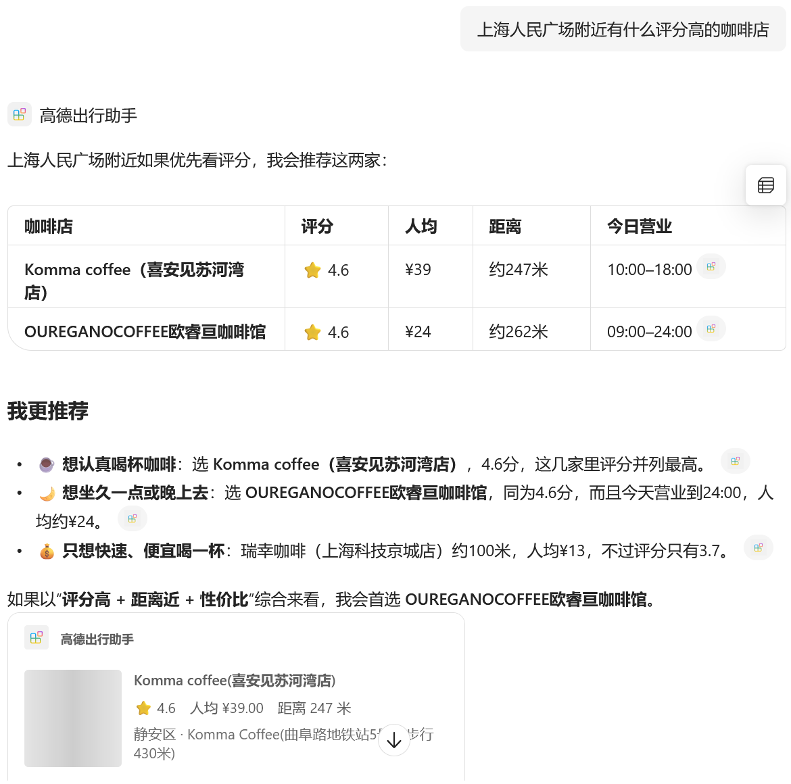
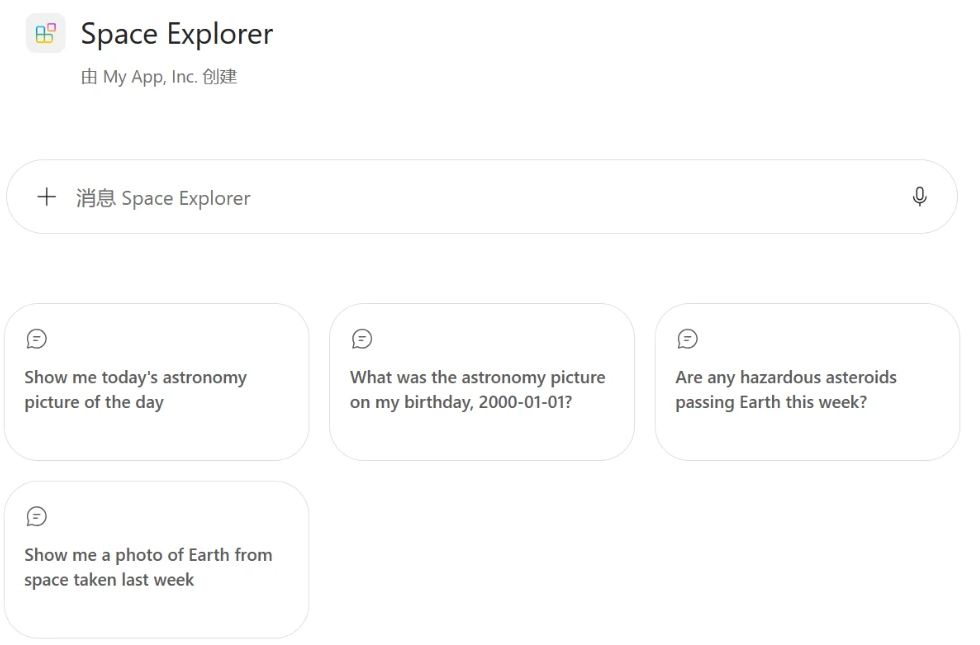
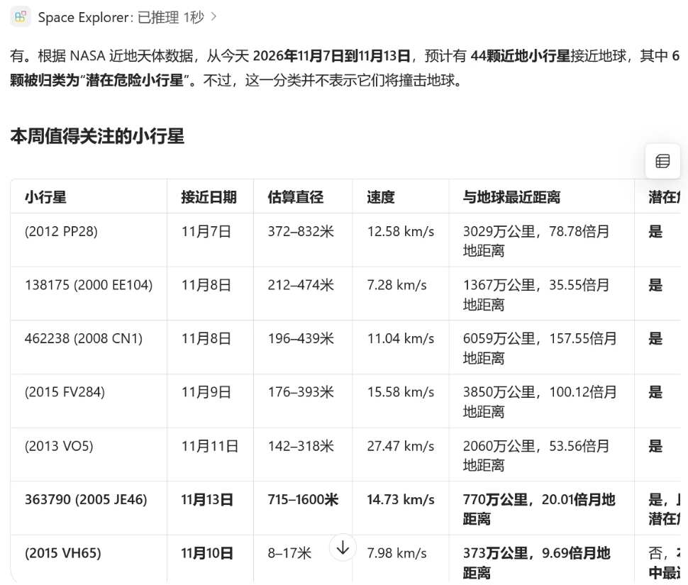
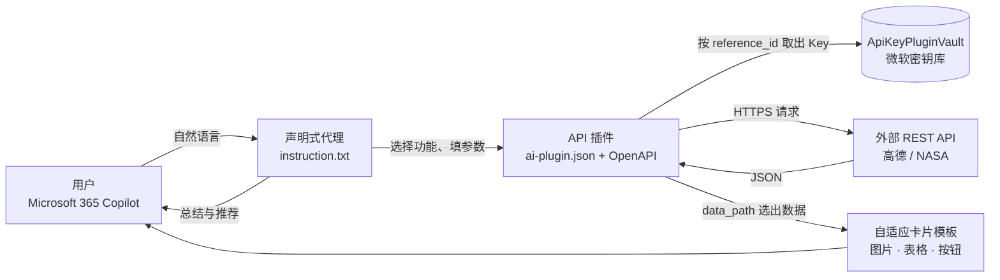

# M365 Copilot Agents — 用声明式代理把外部 API 接进 Microsoft 365 Copilot

> 两个基于 **Microsoft 365 Agents Toolkit** 构建、已部署到 Microsoft 365 Copilot 的声明式代理（Declarative Agent），以及两份从零开始的中文新手教程。
>
> *Two Microsoft 365 Copilot declarative agents built with Microsoft 365 Agents Toolkit — they call external REST APIs (NASA and Amap/Gaode Maps) through API plugins with API-key auth, and render results as Adaptive Cards with images and deep-link actions. Includes beginner tutorials in Chinese.*


---

## 项目一览

| | [高德出行助手](agents/amap-travel-assistant) | [Space Explorer](agents/space-explorer) |
|---|---|---|
| **场景** | 中国城市出行：天气、找店、路线规划 | 太空科普：天文图、近地小行星、地球实拍 |
| **外部 API** | 高德地图 Web 服务（8 个接口，v3 和 v5 混用） | NASA Open APIs（4 个接口） |
| **认证方式** | API Key，放在查询参数（`?key=`） | API Key，放在请求头（`X-Api-Key`） |
| **卡片亮点** | 店铺照片缩略图、逐日预报表、公交方案列表、高德导航按钮 | 地球照片、天文图，上游接口故障时自动降级 |
| **多步调用** | 地址解析 → 周边搜索 / 路线规划 | 小行星列表 → 单颗详情 |

### 高德出行助手

<p>
  
  
</p>

### Space Explorer

<p>
  
  
</p>

---

## 架构



- **声明式代理**：用 JSON 和指令文本定义代理的人设、规则和开场白，不需要自己托管后端服务。
- **API 插件**：Copilot 根据 OpenAPI 文件里的 `description` 决定调用哪个接口、怎么填参数。
- **ApiKeyPluginVault**：Key 由 Toolkit 在 Provision 时注册进微软的密钥库，仓库和代码里都不保存。
- **自适应卡片**：Copilot 不会渲染回答文字里的图片链接，图片、表格和跳转按钮都靠卡片模板实现。

---

## 解决过的工程问题

开发过程中遇到并解决的实际问题（详细过程见教程）：

| 问题 | 原因 | 解决 |
|---|---|---|
| Provision 失败，缺少 `APIKEYAUTH_REGISTRATION_ID` | Toolkit 从 OpenAPI 生成的 `m365agents.yml` 漏掉了 `apiKey/register` 步骤（三个项目都能复现） | 手动补上该步骤，并用 `primaryClientSecret` 从加密的 `.env.dev.user` 读取 Key，实现非交互部署 |
| 公交路线结果不完整 | 高德 v3 接口返回大量轨迹坐标，单次 38.7 KB | 改用 v5 接口加 `show_fields=cost`，降到 7.4 KB |
| 卡片里店铺照片显示为灰块 | 原图 0.2 到 1.4 MB，卡片只显示 96 像素 | 自动识别高德的两种图片服务器，改写成 200 像素缩略图，约 20 KB |
| 回答里只有图片网址，不显示图片 | Copilot 不渲染回答文字中的图片链接 | 改用自适应卡片的 `Image` 元素，用模板表达式拼出图片地址 |
| 卡片里「评分」「人均 ¥」后面是空的 | 高德的空字段是 `""` 或 `[]`，不是 `null` | 条件判断同时检查 `!= null && != ''` |
| 跳转地图会暴露 Key | 高德静态地图接口必须在网址里带 Key | 改用无需 Key 的 `uri.amap.com` 公开链接（标点、导航） |
| NASA 小行星返回结果里带着 Key | NeoWs 的 `links` 字段包含 `api_key=` | 在指令中禁止代理展示该字段 |
| 天文图每天都显示 NASA logo | NASA APOD 接口在网站迁移后出现上游故障 | 卡片检测到后降级为「打开 NASA APOD」按钮，修复后自动恢复 |
| 本地 curl 测中文参数全部失败 | Windows Git Bash 传给 curl 的中文不是 UTF-8 | 定位为本机编码问题，改用 Node.js `fetch` 测试 |
| 卡片写错时难以排查 | Copilot 里只显示空白 | 部署前用 `adaptivecards-templating` 拿真实数据在本地渲染全部卡片 |

---

## 目录结构

```
m365-copilot-agents/
├─ agents/
│  ├─ amap-travel-assistant/          # 高德出行助手（Agents Toolkit 项目）
│  │  ├─ appPackage/
│  │  │  ├─ instruction.txt           #    代理指令：调用顺序、单位换算、输出格式
│  │  │  ├─ ai-plugin.json            #    插件定义：8 个功能、认证、卡片映射
│  │  │  ├─ adaptiveCards/            #    卡片模板：照片、预报表、路线、导航按钮
│  │  │  └─ apiSpecificationFile/     #    Toolkit 处理后的 OpenAPI
│  │  ├─ amap-api.yaml                #    手写的原始 OpenAPI 描述
│  │  ├─ m365agents.yml               #    部署流程（已补 apiKey/register）
│  │  └─ env/.env.dev.user.example    #    Key 配置示例
│  └─ space-explorer/                 # NASA 太空探索（结构相同）
└─ docs/
   ├─ amap/tutorial-zh.md             # 高德版新手教程（含 7 个踩坑记录）
   └─ nasa/tutorial-zh.md             # NASA 版新手教程（含排错速查表）
```

---

## 快速开始

**前提**：VS Code、Node.js LTS、[Microsoft 365 Agents Toolkit](https://marketplace.visualstudio.com/items?itemName=TeamsDevApp.ms-teams-vscode-extension) 扩展，以及一个有 Copilot 许可证、允许上传自定义应用的 Microsoft 365 账号（推荐用开发者租户）。

```bash
git clone https://github.com/zhenyuduan98/m365-copilot-agents.git
```

1. 申请 API Key：高德到 [高德开放平台](https://console.amap.com) 创建「Web服务」类型的 Key；NASA 到 [api.nasa.gov](https://api.nasa.gov) 申请。
2. 进入代理文件夹，把 `env/.env.dev.user.example` 复制为 `env/.env.dev.user`，填入 Key。
3. 用 VS Code 打开该代理文件夹，在 Agents Toolkit 中登录 Microsoft 365，点 **Lifecycle → Provision**。
4. 打开 [Microsoft 365 Copilot](https://m365.cloud.microsoft/chat)，在智能体列表中选择代理，开始提问。

第一次接触声明式代理？建议从教程开始：[高德版教程](docs/amap/tutorial-zh.md) · [NASA 版教程](docs/nasa/tutorial-zh.md)。

---

## 技术栈

- **Microsoft 365 Copilot 扩展**：声明式代理 schema v1.9、API 插件 schema v2.4、Microsoft 365 Agents Toolkit（VS Code 扩展和 `atk` CLI）
- **接口描述与认证**：OpenAPI 3.0、API Key（请求头和查询参数两种方式）、ApiKeyPluginVault
- **界面**：Adaptive Cards 1.5、Adaptive Cards Templating 和表达式语言（`$data`、`$when`、`concat`、`uriComponent` 等）
- **外部服务**：高德地图 Web 服务 API（v3 和 v5）、高德 URI API、NASA Open APIs（APOD、NeoWs、EPIC）

---

## 许可与致谢

- 代码按 [MIT License](LICENSE) 开源。
- 教程中标注「官方文档截图」的图片来自 [Microsoft Learn](https://learn.microsoft.com)，按 CC BY 4.0 许可使用，出处见各教程末尾。
- 灵感来源：Matthew Devaney，[M365 Agents Toolkit: Add A Custom API To An Agent](https://www.matthewdevaney.com/m365-agents-toolkit-add-a-custom-api-to-an-agent/)。
- 数据来源：[高德开放平台](https://lbs.amap.com)、[NASA Open APIs](https://api.nasa.gov)。本项目与高德、NASA、Microsoft 均无官方关联。
