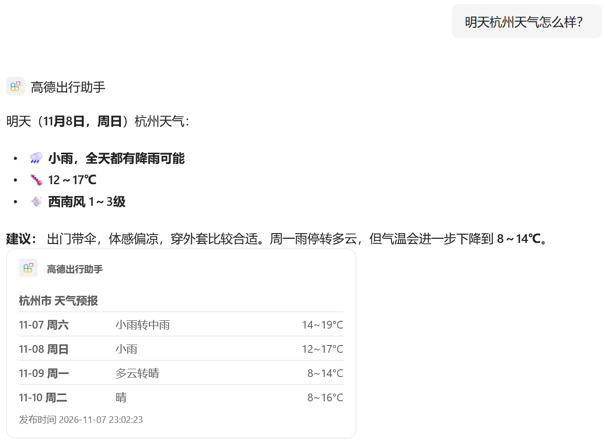
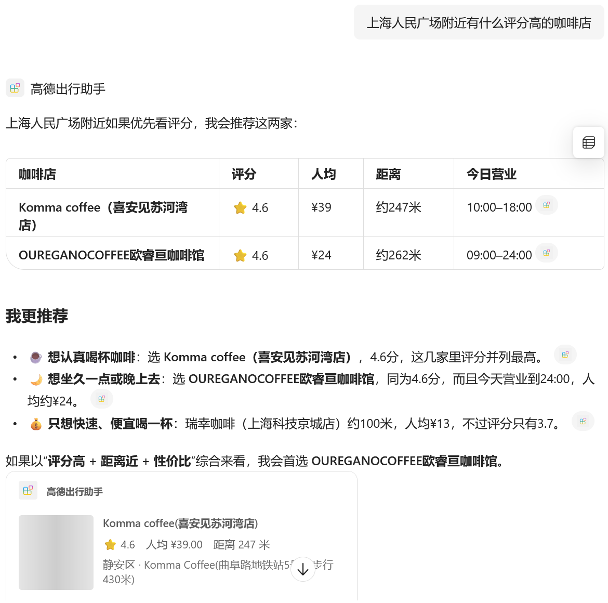

# 高德出行助手 — Amap Travel Assistant Copilot 代理

一个 Microsoft 365 Copilot 声明式代理，调用高德地图 Web 服务 API，回答中国城市的天气、找地点和路线规划问题。

| 能力 | 高德接口 | 结果卡片 |
|---|---|---|
| 实况天气 / 4 天预报 | `v3/weather/weatherInfo` | 实况大字号，或逐日预报表 |
| 关键词搜地点、周边搜索 | `v5/place/text`、`v5/place/around` | 每家店一张卡片：**店铺照片**、评分、人均、营业时间、电话、距离 |
| 地址和坐标互转 | `v3/geocode/geo`、`v3/geocode/regeo` | 地址加「在高德地图中查看」按钮 |
| 步行 / 驾车 / 公交路线 | `v5/direction/walking`、`driving`、`transit/integrated` | 距离、用时、红绿灯、过路费、打车费；公交逐条列出线路和站数；「用高德地图导航」按钮 |

  
  

## 关键实现

- **Key 放在查询参数**（`?key=`），在 OpenAPI 中声明为 `in: query`，由 `ApiKeyPluginVault` 托管。
- **v3 和 v5 混用，控制返回体积**：路线和地点用 v5 接口加 `show_fields`，公交路线的返回数据从 38.7 KB 降到 7.4 KB，避免超出 Copilot 插件的处理上限。
- **多步调用编排**：指令中规定「先地址解析，再周边搜索或路线规划」，公交路线自动使用解析出的 `citycode`，见 [instruction.txt](appPackage/instruction.txt)。
- **每条结果一张卡片**：`ai-plugin.json` 中 `data_path` 设为 `$.pois`、`$.route` 等，见 [ai-plugin.json](appPackage/ai-plugin.json)。
- **照片缩略图优化**：自动识别高德两种图片服务器，改写成 200 像素缩略图（约 1 MB 降到约 20 KB），解决卡片照片加载不出来、显示灰块的问题，见 [searchPlaces1.json](appPackage/adaptiveCards/searchPlaces1.json)。
- **不泄露 Key 的跳转按钮**：使用 `uri.amap.com` 公开链接，不用需要带 Key 的静态地图接口。
- **部署前本地验证**：用 `adaptivecards-templating` 拿真实接口数据渲染全部 9 种卡片后再部署。

## 运行

1. 在 https://console.amap.com 创建 **「Web服务」** 类型的 Key，**不要设置 IP 白名单**。
2. 把 `env/.env.dev.user.example` 复制为 `env/.env.dev.user`，填入 Key。
3. 在 VS Code 中用 Microsoft 365 Agents Toolkit 打开本文件夹，登录 M365，点 **Provision**。

完整的分步教程（含 7 个踩坑记录）：[docs/amap/tutorial-zh.md](../../docs/amap/tutorial-zh.md)。原始 OpenAPI 描述文件：[amap-api.yaml](amap-api.yaml)。
