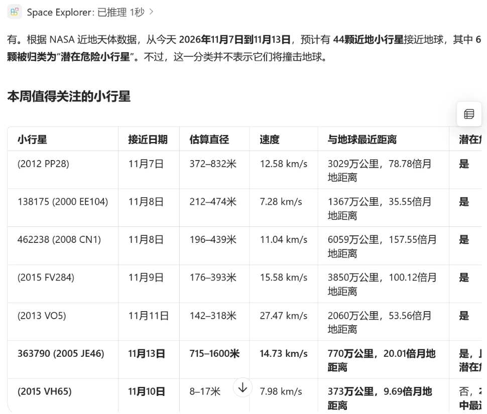

# 🔭 Space Explorer — NASA 太空探索 Copilot 代理

一个 Microsoft 365 Copilot 声明式代理，调用 NASA Open APIs，用自然语言（中英文均可）回答太空问题。

| 能力 | NASA 接口 | 结果卡片 |
|---|---|---|
| 每日天文图（APOD），支持指定日期和随机 | `/planetary/apod` | 标题、图片或视频缩略图、版权，「打开高清图」按钮 |
| 本周飞掠地球的近地小行星，以及潜在危险标记 | `/neo/rest/v1/feed`、`/neo/rest/v1/neo/{id}` | 代理用表格对比直径、速度、距离（含地月距离倍数） |
| DSCOVR 卫星拍摄的整面地球照片 | `/EPIC/api/natural/date/{date}` | 地球照片（自动拼出 JPG 地址），「打开原图」按钮 |

## 关键实现

- **API Key 认证**：`X-Api-Key` 请求头，通过 `ApiKeyPluginVault` 存进微软的密钥库，代码里不出现 Key。
- **补上 `apiKey/register`**：Toolkit 生成的 `m365agents.yml` 缺少这一步，见 [m365agents.yml](m365agents.yml)。
- **自适应卡片显示图片**：Copilot 不会渲染回答文字里的图片链接，所以用卡片模板表达式根据 `date` 和 `image` 字段拼出 EPIC 图片地址，见 [getEarthImages1.json](appPackage/adaptiveCards/getEarthImages1.json)。
- **应对上游接口故障**：APOD 接口目前对所有日期都返回 NASA logo，卡片检测到后降级为「打开 NASA APOD」按钮，指令中也告诉代理忽略错误标题，见 [getApod1.json](appPackage/adaptiveCards/getApod1.json)。
- **防止 Key 泄露**：NeoWs 返回的 `links` 字段里带着 Key，指令中禁止代理展示它，见 [instruction.txt](appPackage/instruction.txt)。

## 运行

1. 到 https://api.nasa.gov 申请 Key。
2. 把 `env/.env.dev.user.example` 复制为 `env/.env.dev.user`，填入 Key。
3. 在 VS Code 中用 Microsoft 365 Agents Toolkit 打开本文件夹，登录 M365，点 **Provision**。

完整的分步教程（含踩坑记录）：[docs/nasa/tutorial-zh.md](../../docs/nasa/tutorial-zh.md)。原始 OpenAPI 描述文件：[nasa-api.yaml](nasa-api.yaml)。
