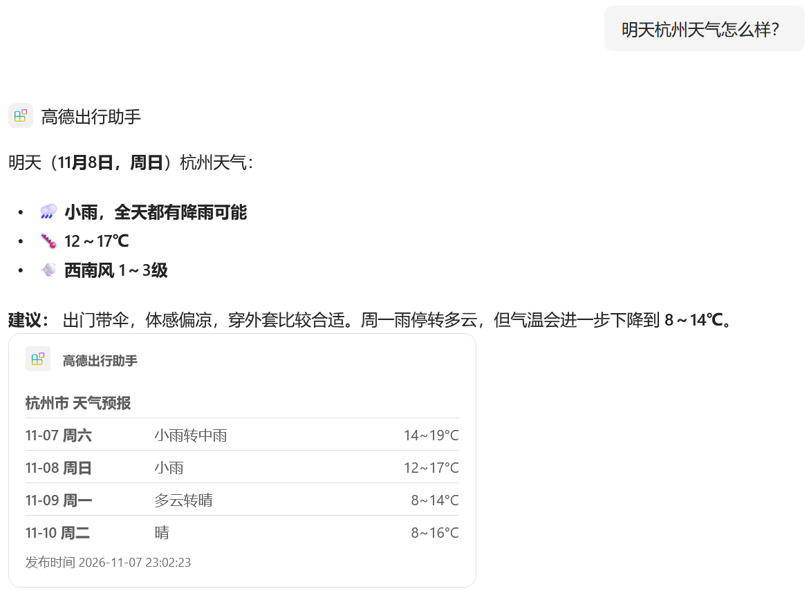
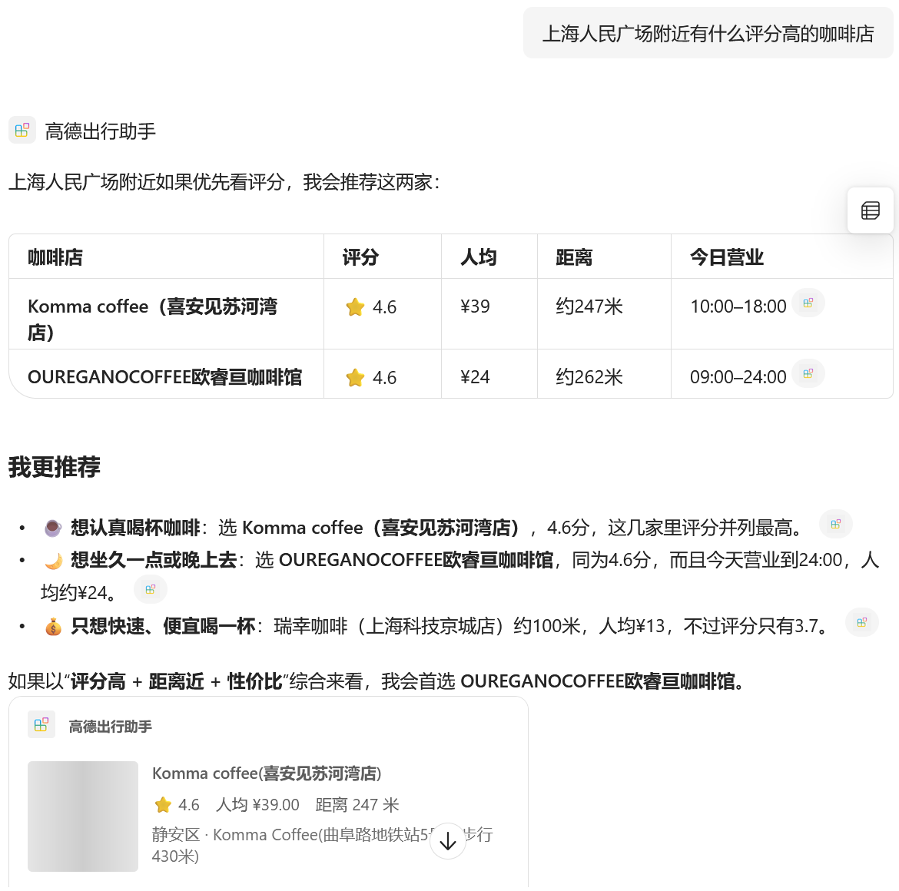
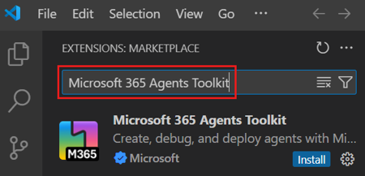
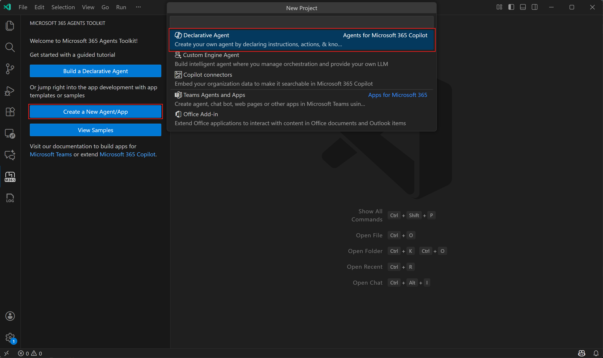
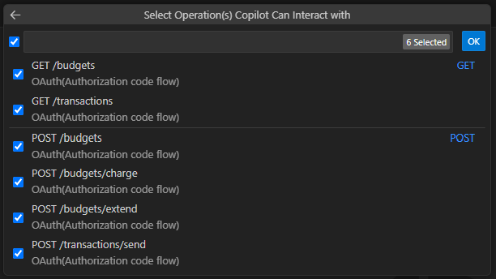
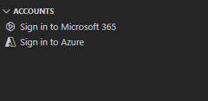
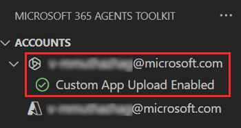
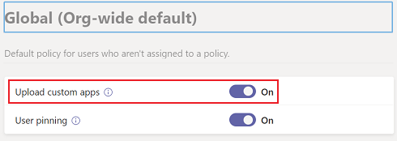
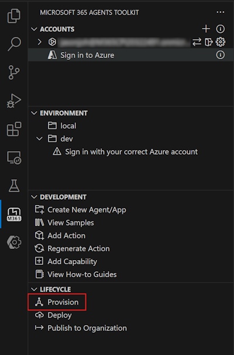
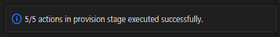

# 新手教程：用 VS Code + Microsoft 365 Agents Toolkit 做一个「高德出行助手」Copilot 代理

> 本教程带你做一个 Microsoft 365 Copilot 里的声明式代理：**高德出行助手**。它调用高德地图 Web 服务 API，可以回答这类问题：
>
> - 「明天杭州天气怎么样？」
> - 「上海人民广场附近有什么评分高的咖啡店？」（结果带店铺照片）
> - 「从天安门坐地铁去军事博物馆怎么走？」
> - 「从杭州东站开车到西湖要多久？」（带「用高德地图导航」按钮）
>
> 教程按真实操作过程编写，把我们踩过的坑标成 ⚠️，放在对应步骤里。第一次做大约需要 1.5 小时。
>
> 📷 截图放在本文件旁边的 `images` 文件夹里，请和本文件一起分享。标注「官方文档截图」的图片来自 [Microsoft Learn](https://learn.microsoft.com)（CC BY 4.0 许可），示例项目名和你的不同，但界面位置一样；其余截图来自本项目的实际运行。

先看看做出来的效果：


*本项目实际截图：问「明天杭州天气怎么样？」，代理给出结论和建议，下方卡片列出 4 天预报。*


*本项目实际截图：问「上海人民广场附近有什么评分高的咖啡店」，代理用表格对比后给出推荐，下方每家店一张卡片，显示评分、人均和距离。照片位置的灰色方块是第一版卡片的问题（原图太大，加载不出来），10.4 节会讲怎么用缩略图解决。*

---

## 目录

1. [先搞懂几个概念](#1-先搞懂几个概念)
2. [准备工作清单](#2-准备工作清单)
3. [第一步：安装 VS Code 扩展](#3-第一步安装-vs-code-扩展)
4. [第二步：申请高德 Key 并测试接口](#4-第二步申请高德-key-并测试接口)
5. [第三步：选接口——v3 还是 v5](#5-第三步选接口v3-还是-v5)
6. [第四步：写 OpenAPI 描述文件](#6-第四步写-openapi-描述文件)
7. [第五步：在 VS Code 里创建代理项目](#7-第五步在-vs-code-里创建代理项目)
8. [第六步：必须检查和修改的配置](#8-第六步必须检查和修改的配置)
9. [第七步：写代理指令](#9-第七步写代理指令)
10. [第八步：设计结果卡片（照片、导航按钮）](#10-第八步设计结果卡片照片导航按钮)
11. [第九步：登录 M365 并 Provision](#11-第九步登录-m365-并-provision)
12. [第十步：在 Copilot 里测试](#12-第十步在-copilot-里测试)
13. [踩坑排错速查表](#13-踩坑排错速查表)
14. [附录 A：命令行（CLI）做法](#附录-a命令行cli做法)
15. [附录 B：完整的 OpenAPI 文件](#附录-b完整的-openapi-文件)
16. [附录 C：完整的卡片模板](#附录-c完整的卡片模板)

---

## 1. 先搞懂几个概念

| 名词 | 一句话解释 |
|---|---|
| **声明式代理（Declarative Agent）** | 一个「定制版 Copilot」。不用写后端代码，用几个 JSON 文件告诉 Copilot：你叫什么、该怎么回答、能调用哪些 API。 |
| **Action / API 插件** | 代理能调用的外部能力，这里就是高德的接口。 |
| **OpenAPI 描述文件** | 一份 YAML 文件，描述 API 的网址、参数、返回数据和认证方式。Copilot 靠它知道怎么调用 API。 |
| **自适应卡片（Adaptive Card）** | 回答下方那张带照片、表格和按钮的卡片。**Copilot 只会在卡片里显示图片，回答文字里的图片链接不会显示成图片。** |
| **Microsoft 365 Agents Toolkit** | VS Code 扩展，负责生成项目、打包、注册密钥、部署到 Copilot。 |
| **Provision** | 部署：把代理上传到你的 Microsoft 365 租户。 |

整个流程如下：

```
申请高德 Key → 测接口 → 写 OpenAPI 文件 → Toolkit 生成项目 → 改配置 → 写指令 → 设计卡片 → 登录 M365 → Provision → 测试
```

---

## 2. 准备工作清单

- [ ] **VS Code**：https://code.visualstudio.com
- [ ] **Node.js（LTS 版本）**：https://nodejs.org 。装好后在终端运行 `node -v`，能看到版本号就行。
- [ ] **高德开放平台账号**：https://lbs.amap.com （支付宝或手机号注册，需要实名认证）。
- [ ] **一个 Microsoft 365 组织账号**，同时满足：
  - 有 **Microsoft 365 Copilot** 许可证；
  - 租户允许 **上传自定义应用（Custom App Upload）**。

> ⚠️ **坑：个人邮箱（Gmail、QQ 等）不能用**，必须是 `xxx@公司.com` 或 `xxx@xxx.onmicrosoft.com` 这类组织账号。公司正式租户通常禁止上传自定义应用，推荐用**开发者租户**（形如 `admin@M365CPIxxxxx.onmicrosoft.com`）。

---

## 3. 第一步：安装 VS Code 扩展

1. 打开 VS Code，按 `Ctrl+Shift+X` 打开扩展面板。
2. 搜索 **Microsoft 365 Agents Toolkit**，然后点 **Install**。

   
   *官方文档截图：搜索并安装。*

3. 装好后，左侧边栏会出现带 **M365** 字样的图标。

   
   *官方文档截图：左侧红框是 Agents Toolkit 图标，右侧红框是后面要用的「Create a New Agent/App」。*

---

## 4. 第二步：申请高德 Key 并测试接口

### 4.1 申请 Key

1. 登录 https://console.amap.com ，进入 **应用管理 → 我的应用 → 创建新应用**，名字随便填（比如「Copilot 出行助手」）。
2. 在应用下点 **添加 Key**：
   - **服务平台选「Web服务」**；
   - **IP 白名单留空**。
3. 提交后会得到一串 32 位的 Key。

> ⚠️ **坑 1：服务平台必须选「Web服务」。** 「Web端（JS API）」、「Android」、「iOS」类型的 Key 不能用来调用 `restapi.amap.com` 接口，会返回 `USERKEY_PLAT_NOMATCH`。
>
> ⚠️ **坑 2：不要设置 IP 白名单。** 调用高德接口的是**微软的云端服务器**，不是你的电脑，IP 不固定。设了白名单，调用会被拒绝（`INVALID_USER_IP`）。
>
> 💡 个人开发者每天有免费调用额度，各接口不同，在控制台的「流量分析」里可以查看用量。自己测试完全够用。

### 4.2 写配置之前，先确认接口能用

**这是最重要的经验：先测接口，再写配置。** 在浏览器地址栏里打开（把 `你的KEY` 换成自己的 Key）：

```
https://restapi.amap.com/v3/weather/weatherInfo?city=杭州&extensions=all&key=你的KEY
https://restapi.amap.com/v3/geocode/geo?address=杭州东站&key=你的KEY
https://restapi.amap.com/v5/place/text?keywords=咖啡&region=上海&page_size=2&show_fields=business,photos&key=你的KEY
https://restapi.amap.com/v5/direction/walking?origin=116.397428,39.90923&destination=116.403119,39.924091&show_fields=cost&key=你的KEY
```

返回的 JSON 里有 `"status":"1"`、`"info":"OK"`，就说明成功了。`"status":"0"` 表示失败，看 `info` 字段了解原因。

> ⚠️ **坑 3：在 Windows 的 Git Bash 里用 curl 测中文参数会失败。** 我们一开始用 curl 测试，所有带中文的请求（地址解析、关键词搜索）都返回 `ENGINE_RESPONSE_DATA_ERROR` 或 0 条结果，只有纯坐标的请求正常。原因是 Git Bash 传给 curl 的中文不是 UTF-8 编码。**接口本身没问题**，用浏览器测试，或者用 Node.js 的 `fetch` 测试就正常。Copilot 那边也不受影响。

### 4.3 高德的 Key 放在哪里

高德的 Key 放在**网址参数**里：`?key=你的KEY`。这决定了 OpenAPI 文件里认证部分的写法（见 6.2）。Copilot 支持这种方式。

> 💡 好消息：高德的天气接口**可以直接传中文城市名**（比如 `city=杭州`），不一定要 6 位城市编码。

---

## 5. 第三步：选接口——v3 还是 v5

高德的 Web 服务有 v3 和 v5 两代接口。我们实测对比了返回数据的大小：

| 接口 | v3 返回 | v5 返回 |
|---|---|---|
| 公交路线 | **38.7 KB** | 7.4 KB |
| 步行路线 | 2.6 KB | 0.7 KB |
| 驾车路线 | 8.4 KB | 8.4 KB |
| 地点搜索（5 条） | 4.9 KB | 4.3 KB |

> ⚠️ **坑 4：返回数据太大，Copilot 可能截断或处理失败。** v3 的路线接口会返回大量轨迹坐标（`polyline`），公交路线动辄几十 KB。v5 接口有个 **`show_fields`** 参数，默认只返回基础字段，需要什么再加，非常适合 Copilot。

最终选择：

| 功能 | 接口 | 原因 |
|---|---|---|
| 天气 | `v3/weather/weatherInfo` | v5 没有天气接口 |
| 地址转坐标 | `v3/geocode/geo` | v5 没有 |
| 坐标转地址 | `v3/geocode/regeo` | v5 没有 |
| 关键词搜地点 | `v5/place/text` | 数据精简；`show_fields=business,photos` 可以拿到评分、人均、营业时间、照片 |
| 周边搜索 | `v5/place/around` | 同上，还会返回距离 |
| 步行 / 驾车 / 公交 | `v5/direction/...` | 用 `show_fields=cost` 拿到时间和费用，不要轨迹坐标 |

---

## 6. 第四步：写 OpenAPI 描述文件

新建文件夹（比如 `C:\Projects\Amap\spec\`），在里面新建 `amap-api.yaml`。**完整内容见[附录 B](#附录-b完整的-openapi-文件)，直接复制即可。** 下面讲关键部分。

### 6.1 一个文件里混用 v3 和 v5

`servers` 只写域名，版本号写进每个路径里：

```yaml
servers:
  - url: https://restapi.amap.com
paths:
  /v3/weather/weatherInfo:
    get:
      operationId: getWeather
      ...
  /v5/place/text:
    get:
      operationId: searchPlaces
      ...
```

### 6.2 认证部分：Key 放在网址参数里

```yaml
security:
  - ApiKeyAuth: []
components:
  securitySchemes:
    ApiKeyAuth:
      type: apiKey
      in: query      # ← 高德放在网址参数里，所以是 query，不是 header
      name: key      # ← 参数名就叫 key
```

> ⚠️ 不要把 `key` 写成普通参数放进每个接口的 `parameters` 里，否则 Copilot 会以为需要用户提供 Key。**只在 `securitySchemes` 里声明**，Toolkit 会把它交给微软的密钥库管理。

### 6.3 用描述「教会」Copilot 怎么调用

Copilot 完全靠 `description` 决定调用哪个接口、怎么填参数，所以要写得具体：

```yaml
- name: show_fields
  in: query
  description: Extra fields to return. Always set to "business,photos" to get rating, cost, opening hours, phone and photos.
```

```yaml
- name: origin
  in: query
  description: Start coordinate as "longitude,latitude" (longitude first), e.g. 116.397428,39.90923.
```

经验：
- **`description` 用英文写**，Copilot 理解得更准确。
- 写清楚格式（**经度在前**、`YYYY-MM-DD`）、取值范围（1-25）和推荐值（"Use 5"）。
- 接口之间的依赖也写进去，比如公交接口的说明里写「需要 citycode，可以从 geocodeAddress 获取」。

---

## 7. 第五步：在 VS Code 里创建代理项目

1. 点左侧的 **Microsoft 365 Agents Toolkit** 图标，再点 **Create a New Agent/App**。
2. 在顶部弹出的 **New Project** 列表里选 **Declarative Agent**。

   
   *官方文档截图。*

3. 选 **Add an Action** → **Start with an OpenAPI Description Document**。
4. 选 **Browse**，找到 `amap-api.yaml`。
5. **勾选全部 8 个接口**，然后点 **OK**。

   
   *官方文档截图：示例里是别的 API。你会看到 `GET /v3/weather/weatherInfo`、`GET /v5/place/text` 等 8 个接口，每个下面标着 API Key 认证。*

6. 选项目存放的文件夹，输入应用名，比如 `AmapTravelAssistant`。
7. VS Code 会打开新窗口，里面就是生成好的项目。

生成的项目结构：

```
AmapTravelAssistant/
├─ appPackage/
│  ├─ manifest.json              ← 应用名、简介、开发者信息
│  ├─ declarativeAgent.json      ← 代理名、开场白
│  ├─ instruction.txt            ← ★ 代理指令（第 9 步）
│  ├─ ai-plugin.json             ← ★ 插件定义：功能列表、认证、卡片配置（第 10 步）
│  ├─ adaptiveCards/             ← ★ 卡片模板（第 10 步）
│  └─ apiSpecificationFile/openapi.yaml   ← 代理实际使用的接口描述
├─ env/
│  ├─ .env.dev                   ← 环境变量（会提交到 git，不能放 Key）
│  └─ .env.dev.user              ← 私密变量（不会提交到 git）
└─ m365agents.yml                ← ★ 部署流程（第 6 步）
```

---

## 8. 第六步：必须检查和修改的配置

### 8.1 ⚠️ 最大的坑：补上 `apiKey/register`

打开 `m365agents.yml`，在 `provision:` 下面找 `apiKey/register`。**我们做过的三个项目（国家公园、NASA、高德），Toolkit 生成的文件都缺这一步。** 缺了它，Key 不会被注册，部署会失败。

在 `teamsApp/create` 那一段**后面**加上（用 2 个空格缩进，不要用 Tab）：

```yaml
  - uses: teamsApp/create
    with:
      name: AmapTravelAssistant${{APP_NAME_SUFFIX}}
    writeToEnvironmentFile:
      teamsAppId: TEAMS_APP_ID

  # ↓↓↓ 加这一段 ↓↓↓
  - uses: apiKey/register
    with:
      name: ApiKeyAuth
      appId: ${{TEAMS_APP_ID}}
      apiSpecPath: ./appPackage/apiSpecificationFile/openapi.yaml
      primaryClientSecret: ${{SECRET_AMAP_API_KEY}}
    writeToEnvironmentFile:
      registrationId: APIKEYAUTH_REGISTRATION_ID
  # ↑↑↑ 加这一段 ↑↑↑
```

### 8.2 把 Key 放进私密文件

`primaryClientSecret` 这一行的作用是让 Toolkit 从环境变量读取 Key，以后每次部署都不用手动粘贴。在 `env/.env.dev.user` 里加一行：

```
SECRET_AMAP_API_KEY=你的高德KEY
```

- `.env.dev.user` 已经被项目的 `.gitignore` 排除，不会提交到 git。
- 以 `SECRET_` 开头的变量，Toolkit 会自动加密保存。

> 💡 不想把 Key 存进文件，也可以删掉 `primaryClientSecret` 那一行。这样 Provision 时 VS Code 会弹出输入框，让你手动粘贴 Key。
>
> ⚠️ **绝对不要把 Key 写进 `.env.dev`、`openapi.yaml` 或卡片模板里。** Key 一旦泄露，去高德控制台删除旧 Key、新建一个，改好 `.env.dev.user` 后重新 Provision。

### 8.3 代理范围改成「个人」

打开 `env/.env.dev`，把 `AGENT_SCOPE=shared` 改成：

```
AGENT_SCOPE=personal
```

> ⚠️ 「共享」范围的代理只要带自定义 API，就需要管理员审批。测试阶段用 `personal`。

### 8.4 改名字、简介和开场白

**`appPackage/manifest.json`**（名字和简介都可以用中文）：

```json
"name": {
    "short": "高德出行助手${{APP_NAME_SUFFIX}}",
    "full": "高德出行助手 Amap Travel Assistant"
},
"description": {
    "short": "查天气、找地点、规划路线",
    "full": "基于高德地图 Web 服务 API：查询中国城市天气，搜索餐厅、咖啡店、景点等地点，并规划步行、驾车和公交路线。"
},
```

同一个文件顶部的 `developer.name` 默认是 `My App, Inc.`。不改的话，Copilot 里代理名字下面会显示「由 My App, Inc. 创建」，建议改成你自己的名字。

**`appPackage/declarativeAgent.json`**：

```json
"name": "高德出行助手",
"conversation_starters": [
    { "text": "明天杭州天气怎么样？" },
    { "text": "上海人民广场附近有什么评分高的咖啡店？" },
    { "text": "从天安门坐地铁去军事博物馆怎么走？" },
    { "text": "从杭州东站开车到西湖要多久？" }
],
```

**`appPackage/ai-plugin.json`**：把 `name_for_human` 改成 `高德出行助手`，它会显示在卡片的标题栏上。

---

## 9. 第七步：写代理指令

`appPackage/instruction.txt` 决定代理的回答质量。默认只有一句话，要替换成具体规则。下面是本项目实际使用的指令，可以直接复制：

```text
You are 高德出行助手 (Amap Travel Assistant), a helpful travel guide for places in China powered by the Amap (Gaode Maps) Web Service API. Answer in the language the user writes in (usually Chinese).

General rules:
- Always pass Chinese place names and keywords to the API (translate English names such as "West Lake" to 西湖 first).
- Coordinates are always "longitude,latitude" with longitude first, for example 116.397428,39.90923.
- Convert units for the user: distance in meters to kilometers (one decimal) when over 1000 m, and duration in seconds to minutes or hours.
- Result cards with photos and "open in Amap" buttons are shown under your answer automatically. Do not paste raw URLs or coordinates unless the user asks.
- Only use data returned by the actions. If status is "0" or nothing is found, tell the user and suggest a more specific place name.

Weather (getWeather):
- Pass the Chinese city or district name directly in city, for example 杭州 or 朝阳区.
- For "now / current / 现在" use extensions=base. For "tomorrow / this week / 明天 / 未来几天" use extensions=all, which covers today and the next 3 days. Forecasts only go 3 days ahead; say so if asked further out.
- Mention weather, temperature range, wind and give a short practical tip (umbrella, jacket).

Finding places:
- searchPlaces: keyword search in a city. Set region to the city and city_limit=true, page_size=5 and show_fields="business,photos".
- searchNearby: "near X / X附近". First call geocodeAddress for X to get its location, then call searchNearby with that location, radius 1000 (increase to 3000 if nothing is found), page_size=5 and show_fields="business,photos".
- Summarize the results as a short list or table with name, rating, average cost per person (business.cost, CNY), today's opening hours, distance (nearby search) and address. Recommend the best match and explain why.

Routes:
- If the user gives place names, call geocodeAddress for both the origin and the destination first (include the city in the address for accuracy) and use the returned location values.
- Walking (getWalkingRoute): for short trips, generally under 5 km.
- Driving (getDrivingRoute): set show_fields="cost". Report distance, duration, tolls, traffic lights and the taxi_cost estimate. Use strategy 33 to avoid congestion if the user mentions traffic.
- Public transit (getTransitRoute): set city1 and city2 to the citycode values returned by geocodeAddress (for example 010 Beijing, 021 Shanghai, 0571 Hangzhou), AlternativeRoute=3 and show_fields="cost". For each option list the lines in order (for example 地铁1号线 天安门西 → 军事博物馆, 4 stops), total time, walking distance and fare. Mention bus_time_tips such as last-train warnings.
- Summarize the key turns in a few steps; do not list every instruction.
- If the user doesn't specify how to travel, compare walking, transit and driving briefly and recommend one.
```

写指令的要点：
- **把接口之间的调用顺序写清楚**：用户说「人民广场附近」，代理要先用 `geocodeAddress` 拿到坐标，再用 `searchNearby` 搜索；规划路线前，也要先把起点和终点的地名转成坐标。
- **把必填的固定参数写进去**：比如 `show_fields="business,photos"`。不写的话，代理可能不传这个参数，返回结果里就没有照片和评分。
- **单位换算**：高德返回的距离单位是米、时间单位是秒，要让代理换算成公里和分钟。
- **告诉代理卡片会显示图片和按钮**，不要在回答里贴网址。

---

## 10. 第八步：设计结果卡片（照片、导航按钮）

### 10.1 为什么要改卡片

Toolkit 自动生成的卡片只有几行原始字段（比如 `name: xxx`、`location: xxx`），不好看，也没有图片。而且：

> **Copilot 不会把回答文字里的图片网址显示成图片，只有卡片里的 `Image` 元素才会显示。**

所以要显示店铺照片，必须改卡片。

### 10.2 先改 `ai-plugin.json`：告诉 Copilot 每张卡片用哪部分数据

`ai-plugin.json` 里每个功能都有一个 `response_semantics`，其中：
- **`data_path`**：卡片使用返回数据的哪一部分。**如果它指向一个数组，数组里每一项会各生成一张卡片。**
- **`static_template`**：用哪个卡片模板文件。

Toolkit 默认都设成 `"$"`（整个返回结果），要改成：

| 功能 | `data_path` | 效果 |
|---|---|---|
| searchPlaces / searchNearby | `$.pois` | **每家店一张卡片** |
| geocodeAddress | `$.geocodes` | 每个匹配地址一张卡片 |
| reverseGeocode | `$.regeocode` | 一张地址卡片 |
| getWalkingRoute / getDrivingRoute / getTransitRoute | `$.route` | 一张路线卡片（能读到起点和终点坐标，用来生成导航按钮） |
| getWeather | `$` | 一张天气卡片（同时兼容实况和预报两种返回格式） |

例如：

```json
{
    "name": "searchPlaces",
    "capabilities": {
        "response_semantics": {
            "data_path": "$.pois",
            "properties": {
                "title": "$.name",
                "subtitle": "$.address"
            },
            "static_template": {
                "file": "adaptiveCards/searchPlaces1.json"
            }
        }
    }
}
```

### 10.3 地点卡片：照片加评分加按钮

`adaptiveCards/searchPlaces1.json` 的核心部分（完整版见[附录 C](#附录-c完整的卡片模板)）：

```json
{
    "type": "Image",
    "url": "${...缩略图地址，见 10.4...}",
    "width": "96px",
    "height": "96px"
},
{
    "type": "TextBlock",
    "text": "${name}",
    "weight": "Bolder"
},
{
    "type": "TextBlock",
    "text": "${if(business.rating != null && business.rating != '', concat('⭐ ', business.rating, '　'), '')}${if(business.cost != null && business.cost != '', concat('人均 ¥', business.cost), '')}"
}
```

模板语法速记：

| 写法 | 含义 |
|---|---|
| `${name}` | 取返回数据里的 `name` 字段 |
| `${photos[0].url}` | 取第一张照片的地址 |
| `${if(条件, 是, 否)}` | 条件判断，常用来处理字段为空的情况 |
| `${concat('a', 'b')}` | 拼接字符串 |
| `"$when": "${条件}"` | 条件不满足时，整个元素不显示（比如没有照片就不显示照片列） |
| `"$data": "${数组}"` | 对数组的每一项重复这个元素（比如天气的每一天、公交的每个方案） |

> ⚠️ **坑 5：高德的空字段不是 `null`，而是空字符串 `""` 或空数组 `[]`。** 判断时要写成 `business.rating != null && business.rating != ''`，否则卡片会显示「⭐ 」后面什么都没有，或者「人均 ¥」后面是空的。

### 10.4 ⚠️ 坑 6：照片显示成灰色方块——用缩略图

第一版卡片直接用了高德返回的照片地址，结果在 Copilot 里**照片位置是一块灰色**，迟迟不显示（见开头的效果截图）。

排查发现：照片地址本身没问题，但**原图太大**，从 222 KB 到 1.4 MB 都有，卡片里却只显示成 96 像素的小图。于是我们找到了高德两种图片服务器的缩略图写法：

| 照片来源 | 原图大小 | 缩略图写法 | 缩略图大小 |
|---|---|---|---|
| `aos-comment.amap.com`（用户评论图） | 约 1.4 MB | 原地址后加 `?x-oss-process=image/resize,w_200` | 约 19 KB |
| `store.is.autonavi.com/showpic/...`（店铺图） | 约 1 MB | 去掉原来的 `?type=pic`，换成 `?operate=merge&w=200&h=200&position=5` | 约 22 KB |

图片小了约 50 倍。卡片里的写法（自动判断照片来自哪个服务器）：

```
${if(contains(photos[0].url, 'aos-comment.amap.com'),
     concat(photos[0].url, if(contains(photos[0].url, '?'), '&', '?'), 'x-oss-process=image/resize,w_200'),
     if(contains(photos[0].url, 'store.is.autonavi.com/showpic'),
        concat(first(split(photos[0].url, '?')), '?operate=merge&w=200&h=200&position=5'),
        photos[0].url))}
```

（写进 JSON 时要放在同一行，附录 C 里是可以直接复制的版本。）

### 10.5 导航按钮：用 `uri.amap.com`，不泄露 Key

高德有一套**不需要 Key** 的公开链接，点击后会跳转到高德地图网页版或手机 App：

| 用途 | 链接格式 |
|---|---|
| 在地图上标出一个点 | `https://uri.amap.com/marker?position=经度,纬度&name=名称` |
| 导航 | `https://uri.amap.com/navigation?from=经度,纬度&to=经度,纬度&mode=car` （`mode` 可选 `car`、`walk`、`bus`） |

卡片里的按钮写法：

```json
"actions": [
    {
        "type": "Action.OpenUrl",
        "title": "在高德地图中查看",
        "url": "${concat('https://uri.amap.com/marker?position=', location, '&name=', uriComponent(name), '&src=copilot&coordinate=gaode&callnative=0')}"
    }
]
```

- `uriComponent(name)` 对中文店名做 URL 编码，否则链接会出错。
- 路线卡片的 `data_path` 设成 `$.route`，正是为了读到 `origin`（起点）和 `destination`（终点）坐标来生成导航链接。

> ⚠️ **坑 7：不要用高德「静态地图」接口在卡片里显示地图图片。** 静态地图的网址里必须带 `key=`，写进卡片后，任何人右键复制图片地址就能拿到你的 Key。用上面的 `uri.amap.com` 按钮代替。

### 10.6 部署前先在本地验证卡片

卡片写错时，Copilot 里只会显示空白或报错，很难排查。我们用微软官方的模板库，拿真实接口数据在本地「渲染」一遍，部署前就能发现问题：

```bash
mkdir cardtest && cd cardtest && npm init -y && npm i adaptivecards-templating adaptive-expressions
```

然后写一个小脚本 `render.mjs`：

```js
import T from "adaptivecards-templating";
import fs from "fs";

const KEY = "你的KEY";
const card = JSON.parse(fs.readFileSync("../AmapTravelAssistant/appPackage/adaptiveCards/searchPlaces1.json", "utf8"));

const url = new URL("https://restapi.amap.com/v5/place/text");
url.search = new URLSearchParams({ keywords: "咖啡", region: "上海", page_size: "2", show_fields: "business,photos", key: KEY });
const data = await (await fetch(url)).json();

for (const poi of data.pois) {   // 对应 data_path: $.pois
  const out = new T.Template(card).expand({ $root: poi });
  console.log(JSON.stringify(out, null, 2));
}
```

运行 `node render.mjs`，检查输出里的文字、图片地址和按钮链接是否正确。我们用这个方法验证了全部 9 种卡片的效果，比如：

```
星巴克(人民公园店)
⭐ 4.5　人均 ¥30.00
黄浦区 · 南京西路189号(近人民广场9号出口)
今日营业=07:00-22:30
按钮: 在高德地图中查看 -> https://uri.amap.com/marker?position=121.470875,31.231675&name=%E6%98%9F%E5%B7%B4...
```

---

## 11. 第九步：登录 M365 并 Provision

### 11.1 登录

1. 在 Agents Toolkit 侧边栏的 **ACCOUNTS** 面板，点 **Sign in to Microsoft 365**。

   
   *官方文档截图。*

2. 在浏览器里用有 Copilot 许可证的组织账号登录。
3. 回到 VS Code，确认账号下面有两个绿色对勾：**Custom App Upload Enabled** 和 **Copilot Access Enabled**。

   
   *官方文档截图。*

> ⚠️ 任何一个不是绿勾，Provision 都会失败。这时请换开发者租户，或者请管理员在 Teams 管理中心打开下面这个开关（Teams 应用 → 设置策略 → 全局）：
>
> 

### 11.2 Provision

1. 在 **LIFECYCLE** 面板点 **Provision**，环境选 **dev**。

   
   *官方文档截图。*

2. 如果你按 8.2 配置了 `.env.dev.user`，就不会弹出输入 Key 的提示框；否则按提示粘贴 Key。
3. 等待 1 到 3 分钟，右下角会提示成功：

   
   *官方文档截图：示例是 5/5；本项目多了 `apiKey/register`，所以是 6/6。*

**输出（Output）** 面板里应该能看到 6 个步骤全部完成：

```
(√) teamsApp/create             创建应用
(√) apiKey/register             把高德 Key 注册进密钥库   ← 一定要有这一行
(√) teamsApp/zipAppPackage      打包
(√) teamsApp/validateAppPackage 校验
(√) teamsApp/update             更新应用
(√) copilotAgent/publish        发布到 Copilot
```

**以后修改了指令、卡片或名字，都要重新点 Provision**，然后在 Copilot 里**新开一个对话**测试。旧对话不会刷新。

---

## 12. 第十步：在 Copilot 里测试

打开代理有两种方法：

- **方法一：** 浏览器打开 `https://m365.cloud.microsoft/chat/?titleId=M365_TITLE_ID的值`。这个值在 `env/.env.dev` 里，是 Provision 时自动写入的。
- **方法二：** 打开 https://m365.cloud.microsoft/chat ，在左侧 **智能体和技能** 列表里找到 **高德出行助手dev**。名字末尾的 `dev` 是开发版自动加的后缀。

建议依次测试这几类问题：

| 测试问题 | 预期效果 |
|---|---|
| 明天杭州天气怎么样？ | 文字结论加建议，卡片显示 4 天预报 |
| 上海人民广场附近有什么评分高的咖啡店？ | 对比表格加推荐，每家店一张带照片的卡片 |
| 从天安门坐地铁去军事博物馆怎么走？ | 2 到 3 个方案，列出线路、站数、时间和票价，以及「用高德地图查看公交路线」按钮 |
| 从杭州东站开车到西湖要多久？ | 距离、时间、红绿灯数、打车费，以及「用高德地图导航」按钮 |

注意事项：
- 第一次调用时，Copilot 可能会询问是否允许访问 `restapi.amap.com`，点**允许**。
- 刚部署完找不到代理，等几分钟再刷新。
- 答案不对时，先在浏览器里直接打开对应的高德接口，看返回数据对不对，再判断是代理、卡片还是接口的问题。

---

## 13. 踩坑排错速查表

| 现象 | 原因 | 解决办法 |
|---|---|---|
| 接口返回 `USERKEY_PLAT_NOMATCH` | Key 的服务平台不是「Web服务」 | 在控制台新建一个「Web服务」类型的 Key |
| 接口返回 `INVALID_USER_IP` | Key 设了 IP 白名单 | 清空白名单（调用来自微软云端，IP 不固定） |
| 接口返回 `INVALID_USER_KEY` | Key 填错了，或者已被删除 | 检查 `.env.dev.user`，然后重新 Provision |
| 用 curl 测试中文参数返回 `ENGINE_RESPONSE_DATA_ERROR` 或 0 条结果 | Windows Git Bash 的中文编码问题 | 改用浏览器或 Node.js 测试，接口本身没问题 |
| 返回 `DAILY_QUERY_OVER_LIMIT` | 当天的免费额度用完了 | 第二天再试，或者在控制台申请提高额度 |
| Provision 报缺少 `APIKEYAUTH_REGISTRATION_ID` | `m365agents.yml` 缺 `apiKey/register` | 按 8.1 补上 |
| Provision 报无权上传 / 自定义应用被禁用 | 租户没开 Custom App Upload | 换开发者租户，或者请管理员开通 |
| 路线结果不完整，或者代理说处理失败 | 用了 v3 路线接口，返回数据太大 | 改用 v5 接口，加上 `show_fields=cost` |
| 地点卡片没有评分、照片 | 代理没传 `show_fields=business,photos` | 在指令和 OpenAPI 描述里写明「Always set to ...」 |
| 卡片显示「⭐ 」「人均 ¥」后面是空的 | 高德的空字段是 `""`，不是 `null` | 条件里同时判断 `!= null && != ''` |
| 照片是灰色方块，迟迟不显示 | 原图太大（最大约 1.4 MB） | 用 10.4 节的缩略图写法 |
| 回答里只有网址，没有图片 | Copilot 不渲染文字里的图片 | 把图片放进卡片的 `Image` 元素 |
| 导航按钮打开后位置不对 | 坐标写反了（纬度在前） | 高德的坐标格式是「经度,纬度」，经度在前 |
| 改了配置，Copilot 里没变化 | 还在看旧对话 | 重新 Provision 后新开对话 |

---

## 附录 A：命令行（CLI）做法

```bash
# 安装 CLI
npm install -g --allow-scripts=@microsoft/m365agentstoolkit-cli,@azure/msal-node-extensions,keytar @microsoft/m365agentstoolkit-cli
```

```bash
# 从 OpenAPI 文件生成项目（⚠️ 路径必须用绝对路径，相对路径会报找不到文件）
atk new -c declarative-agent --with-plugin yes --api-plugin-type api-spec --openapi-spec-location "C:\Projects\Amap\spec\amap-api.yaml" --api-operation "GET /v3/weather/weatherInfo,GET /v3/geocode/geo,GET /v3/geocode/regeo,GET /v5/place/text,GET /v5/place/around,GET /v5/direction/walking,GET /v5/direction/driving,GET /v5/direction/transit/integrated" --api-auth api-key -n AmapTravelAssistant -f "C:\Projects\Amap" -i false
```

```bash
# 登录 Microsoft 365（会打开浏览器）
atk auth login m365
```

```bash
# 校验清单（Provision 前注册编号还没生成，用占位值只检查格式；Git Bash 写法）
APIKEYAUTH_REGISTRATION_ID=placeholder TEAMS_APP_ID=00000000-0000-0000-0000-000000000000 atk validate --manifest-file ./appPackage/manifest.json --env dev -i false
```

```bash
# 部署（需要先按 8.1 和 8.2 配好 primaryClientSecret）
atk provision --env dev -i false
```

---

## 附录 B：完整的 OpenAPI 文件

保存为 `amap-api.yaml`：

```yaml
openapi: 3.0.0
info:
  title: Amap Travel API
  description: Weather, place search, geocoding and route planning in China from Amap (Gaode Maps) Web Service API.
  version: 1.0.0
servers:
  - url: https://restapi.amap.com
paths:
  /v3/weather/weatherInfo:
    get:
      operationId: getWeather
      summary: Get weather for a Chinese city
      description: Returns live weather (extensions=base) or a 4-day forecast (extensions=all) for a city or district in China.
      parameters:
        - name: city
          in: query
          description: City or district name in Chinese (e.g. 杭州, 朝阳区) or its 6-digit adcode (e.g. 330100).
          required: true
          schema:
            type: string
        - name: extensions
          in: query
          description: base returns current weather; all returns today's and the next 3 days' forecast.
          required: false
          schema:
            type: string
            enum: [base, all]
      responses:
        '200':
          description: Weather data. lives is filled for base, forecasts for all.
          content:
            application/json:
              schema:
                $ref: '#/components/schemas/WeatherResponse'
  /v3/geocode/geo:
    get:
      operationId: geocodeAddress
      summary: Convert an address or place name to coordinates
      description: Converts a structured address or well-known place name in China to longitude,latitude coordinates and administrative codes. Use it before route planning when the user gives place names instead of coordinates.
      parameters:
        - name: address
          in: query
          description: Address in Chinese, e.g. 北京市朝阳区阜通东大街6号 or 杭州西湖. Include the city name for better accuracy.
          required: true
          schema:
            type: string
        - name: city
          in: query
          description: Optional city name, citycode or adcode to limit the search.
          required: false
          schema:
            type: string
      responses:
        '200':
          description: Matching locations.
          content:
            application/json:
              schema:
                $ref: '#/components/schemas/GeocodeResponse'
  /v3/geocode/regeo:
    get:
      operationId: reverseGeocode
      summary: Convert coordinates to an address
      description: Returns the address, district and nearby business areas for a longitude,latitude coordinate in China.
      parameters:
        - name: location
          in: query
          description: Coordinate as "longitude,latitude", e.g. 120.148732,30.242489.
          required: true
          schema:
            type: string
      responses:
        '200':
          description: Address for the coordinate.
          content:
            application/json:
              schema:
                type: object
                properties:
                  status:
                    type: string
                  regeocode:
                    type: object
                    properties:
                      formatted_address:
                        type: string
                      addressComponent:
                        type: object
                        properties:
                          province:
                            type: string
                          city:
                            type: string
                          district:
                            type: string
                          township:
                            type: string
                          adcode:
                            type: string
  /v5/place/text:
    get:
      operationId: searchPlaces
      summary: Search places by keyword in a city
      description: Searches points of interest (restaurants, cafes, hotels, attractions, shops, stations...) by keyword within a city. Returns name, address, coordinates, rating, average cost, opening hours, phone and photos.
      parameters:
        - name: keywords
          in: query
          description: Search keyword in Chinese, e.g. 咖啡, 火锅, 酒店, 西湖.
          required: true
          schema:
            type: string
        - name: region
          in: query
          description: City name, citycode or adcode to search in, e.g. 上海.
          required: false
          schema:
            type: string
        - name: city_limit
          in: query
          description: Set to true to only return results inside region.
          required: false
          schema:
            type: boolean
        - name: page_size
          in: query
          description: Number of results per page, 1-25. Use 5 unless the user asks for more.
          required: false
          schema:
            type: integer
        - name: page_num
          in: query
          description: Page number, starting from 1.
          required: false
          schema:
            type: integer
        - name: show_fields
          in: query
          description: Extra fields to return. Always set to "business,photos" to get rating, cost, opening hours, phone and photos.
          required: false
          schema:
            type: string
      responses:
        '200':
          description: Matching places.
          content:
            application/json:
              schema:
                $ref: '#/components/schemas/PlaceResponse'
  /v5/place/around:
    get:
      operationId: searchNearby
      summary: Search places near a coordinate
      description: Searches points of interest within a radius around a longitude,latitude coordinate, sorted by distance. Get the coordinate with geocodeAddress first if the user gives a place name.
      parameters:
        - name: location
          in: query
          description: Center coordinate as "longitude,latitude".
          required: true
          schema:
            type: string
        - name: keywords
          in: query
          description: Search keyword in Chinese, e.g. 咖啡, 地铁站, 停车场.
          required: false
          schema:
            type: string
        - name: radius
          in: query
          description: Search radius in meters, 0-50000. Default 5000.
          required: false
          schema:
            type: integer
        - name: sortrule
          in: query
          description: distance (default) or weight (overall relevance).
          required: false
          schema:
            type: string
            enum: [distance, weight]
        - name: page_size
          in: query
          description: Number of results per page, 1-25. Use 5 unless the user asks for more.
          required: false
          schema:
            type: integer
        - name: show_fields
          in: query
          description: Extra fields to return. Always set to "business,photos".
          required: false
          schema:
            type: string
      responses:
        '200':
          description: Nearby places with distance in meters.
          content:
            application/json:
              schema:
                $ref: '#/components/schemas/PlaceResponse'
  /v5/direction/walking:
    get:
      operationId: getWalkingRoute
      summary: Plan a walking route
      description: Plans a walking route between two coordinates (best for under about 5 km). Returns distance in meters, duration in seconds and turn-by-turn steps.
      parameters:
        - $ref: '#/components/parameters/origin'
        - $ref: '#/components/parameters/destination'
        - $ref: '#/components/parameters/routeShowFields'
      responses:
        '200':
          description: Walking route.
          content:
            application/json:
              schema:
                $ref: '#/components/schemas/RouteResponse'
  /v5/direction/driving:
    get:
      operationId: getDrivingRoute
      summary: Plan a driving route
      description: Plans a driving route between two coordinates. Returns distance, duration, tolls, traffic lights, taxi cost estimate and turn-by-turn steps.
      parameters:
        - $ref: '#/components/parameters/origin'
        - $ref: '#/components/parameters/destination'
        - name: strategy
          in: query
          description: Route preference. 32 = default recommendation, 33 = avoid congestion, 34 = prefer highways, 35 = avoid highways, 36 = avoid tolls.
          required: false
          schema:
            type: integer
        - $ref: '#/components/parameters/routeShowFields'
      responses:
        '200':
          description: Driving routes.
          content:
            application/json:
              schema:
                $ref: '#/components/schemas/RouteResponse'
  /v5/direction/transit/integrated:
    get:
      operationId: getTransitRoute
      summary: Plan a public transit route
      description: Plans public transport routes (subway, bus, walking) between two coordinates. Requires the citycode (e.g. 010 Beijing, 021 Shanghai, 0571 Hangzhou) of the origin and destination cities, which geocodeAddress returns.
      parameters:
        - $ref: '#/components/parameters/origin'
        - $ref: '#/components/parameters/destination'
        - name: city1
          in: query
          description: citycode of the origin city, e.g. 010.
          required: true
          schema:
            type: string
        - name: city2
          in: query
          description: citycode of the destination city, e.g. 010.
          required: true
          schema:
            type: string
        - name: AlternativeRoute
          in: query
          description: Number of alternative routes to return, 1-10. Use 3.
          required: false
          schema:
            type: integer
        - $ref: '#/components/parameters/routeShowFields'
      responses:
        '200':
          description: Transit routes.
          content:
            application/json:
              schema:
                $ref: '#/components/schemas/TransitResponse'
security:
  - ApiKeyAuth: []
components:
  securitySchemes:
    ApiKeyAuth:
      type: apiKey
      in: query
      name: key
  parameters:
    origin:
      name: origin
      in: query
      description: Start coordinate as "longitude,latitude" (longitude first), e.g. 116.397428,39.90923.
      required: true
      schema:
        type: string
    destination:
      name: destination
      in: query
      description: End coordinate as "longitude,latitude" (longitude first).
      required: true
      schema:
        type: string
    routeShowFields:
      name: show_fields
      in: query
      description: Extra fields to return. Always set to "cost" to get duration, tolls and fares.
      required: false
      schema:
        type: string
  schemas:
    WeatherResponse:
      type: object
      properties:
        status:
          type: string
        lives:
          type: array
          items:
            type: object
            properties:
              province:
                type: string
              city:
                type: string
              weather:
                type: string
              temperature:
                type: string
              winddirection:
                type: string
              windpower:
                type: string
              humidity:
                type: string
              reporttime:
                type: string
        forecasts:
          type: array
          items:
            type: object
            properties:
              city:
                type: string
              province:
                type: string
              reporttime:
                type: string
              casts:
                type: array
                items:
                  type: object
                  properties:
                    date:
                      type: string
                    week:
                      type: string
                    dayweather:
                      type: string
                    nightweather:
                      type: string
                    daytemp:
                      type: string
                    nighttemp:
                      type: string
                    daywind:
                      type: string
                    daypower:
                      type: string
    GeocodeResponse:
      type: object
      properties:
        status:
          type: string
        count:
          type: string
        geocodes:
          type: array
          items:
            type: object
            properties:
              formatted_address:
                type: string
              province:
                type: string
              city:
                type: string
              district:
                type: string
              citycode:
                type: string
              adcode:
                type: string
              location:
                type: string
                description: longitude,latitude
              level:
                type: string
    PlaceResponse:
      type: object
      properties:
        status:
          type: string
        count:
          type: string
        pois:
          type: array
          items:
            type: object
            properties:
              id:
                type: string
              name:
                type: string
              type:
                type: string
              address:
                type: string
              location:
                type: string
                description: longitude,latitude
              cityname:
                type: string
              adname:
                type: string
              distance:
                type: string
                description: Distance in meters (nearby search only).
              business:
                type: object
                properties:
                  rating:
                    type: string
                  cost:
                    type: string
                    description: Average cost per person in CNY.
                  tel:
                    type: string
                  opentime_today:
                    type: string
                  opentime_week:
                    type: string
                  tag:
                    type: string
                  business_area:
                    type: string
              photos:
                type: array
                items:
                  type: object
                  properties:
                    title:
                      type: string
                    url:
                      type: string
    RouteResponse:
      type: object
      properties:
        status:
          type: string
        route:
          type: object
          properties:
            origin:
              type: string
            destination:
              type: string
            taxi_cost:
              type: string
              description: Estimated taxi fare in CNY (driving only).
            paths:
              type: array
              items:
                type: object
                properties:
                  distance:
                    type: string
                    description: Meters.
                  cost:
                    type: object
                    properties:
                      duration:
                        type: string
                        description: Seconds.
                      tolls:
                        type: string
                      traffic_lights:
                        type: string
                  steps:
                    type: array
                    items:
                      type: object
                      properties:
                        instruction:
                          type: string
                        road_name:
                          type: string
                        step_distance:
                          type: string
    TransitResponse:
      type: object
      properties:
        status:
          type: string
        route:
          type: object
          properties:
            origin:
              type: string
            destination:
              type: string
            distance:
              type: string
            transits:
              type: array
              items:
                type: object
                properties:
                  distance:
                    type: string
                  walking_distance:
                    type: string
                  cost:
                    type: object
                    properties:
                      duration:
                        type: string
                        description: Seconds.
                      transit_fee:
                        type: string
                        description: Fare in CNY.
                  segments:
                    type: array
                    items:
                      type: object
                      properties:
                        bus:
                          type: object
                          properties:
                            buslines:
                              type: array
                              items:
                                type: object
                                properties:
                                  name:
                                    type: string
                                  type:
                                    type: string
                                  via_num:
                                    type: string
                                  departure_stop:
                                    type: object
                                    properties:
                                      name:
                                        type: string
                                  arrival_stop:
                                    type: object
                                    properties:
                                      name:
                                        type: string
                                  bus_time_tips:
                                    type: string
```

---

## 附录 C：完整的卡片模板

放在 `appPackage/adaptiveCards/` 里，文件名要和 `ai-plugin.json` 里 `static_template` 指定的一致。

### `searchPlaces1.json`：地点卡片（searchNearby1.json 内容相同，复制一份即可）

```json
{
    "type": "AdaptiveCard",
    "$schema": "https://adaptivecards.io/schemas/adaptive-card.json",
    "version": "1.5",
    "body": [
        {
            "type": "ColumnSet",
            "columns": [
                {
                    "type": "Column",
                    "width": "auto",
                    "$when": "${photos != null && count(photos) > 0}",
                    "items": [
                        {
                            "type": "Image",
                            "url": "${if(contains(photos[0].url, 'aos-comment.amap.com'), concat(photos[0].url, if(contains(photos[0].url, '?'), '&', '?'), 'x-oss-process=image/resize,w_200'), if(contains(photos[0].url, 'store.is.autonavi.com/showpic'), concat(first(split(photos[0].url, '?')), '?operate=merge&w=200&h=200&position=5'), photos[0].url))}",
                            "altText": "${name}",
                            "width": "96px",
                            "height": "96px"
                        }
                    ]
                },
                {
                    "type": "Column",
                    "width": "stretch",
                    "items": [
                        {
                            "type": "TextBlock",
                            "text": "${name}",
                            "weight": "Bolder",
                            "size": "Medium",
                            "wrap": true
                        },
                        {
                            "type": "TextBlock",
                            "text": "${if(business.rating != null && business.rating != '', concat('⭐ ', business.rating, '　'), '')}${if(business.cost != null && business.cost != '', concat('人均 ¥', business.cost, '　'), '')}${if(distance != null && distance != '', concat('距离 ', distance, ' 米'), '')}",
                            "wrap": true,
                            "spacing": "Small"
                        },
                        {
                            "type": "TextBlock",
                            "text": "${if(adname != null && adname != '', concat(adname, ' · '), '')}${address}",
                            "isSubtle": true,
                            "wrap": true,
                            "spacing": "Small"
                        }
                    ]
                }
            ]
        },
        {
            "type": "FactSet",
            "facts": [
                {
                    "$when": "${business.opentime_today != null && business.opentime_today != ''}",
                    "title": "今日营业",
                    "value": "${business.opentime_today}"
                },
                {
                    "$when": "${business.tel != null && business.tel != ''}",
                    "title": "电话",
                    "value": "${business.tel}"
                },
                {
                    "$when": "${business.tag != null && business.tag != ''}",
                    "title": "推荐",
                    "value": "${business.tag}"
                }
            ]
        }
    ],
    "actions": [
        {
            "type": "Action.OpenUrl",
            "title": "在高德地图中查看",
            "url": "${concat('https://uri.amap.com/marker?position=', location, '&name=', uriComponent(name), '&src=copilot&coordinate=gaode&callnative=0')}"
        }
    ]
}
```

### `getWeather1.json`：天气卡片（同时兼容实况和预报）

```json
{
    "type": "AdaptiveCard",
    "$schema": "https://adaptivecards.io/schemas/adaptive-card.json",
    "version": "1.5",
    "body": [
        {
            "type": "Container",
            "$when": "${lives != null && count(lives) > 0}",
            "items": [
                {
                    "type": "TextBlock",
                    "text": "${lives[0].city} 实时天气",
                    "weight": "Bolder",
                    "size": "Medium"
                },
                {
                    "type": "TextBlock",
                    "text": "${lives[0].weather}　${lives[0].temperature}°C",
                    "size": "ExtraLarge",
                    "spacing": "Small"
                },
                {
                    "type": "FactSet",
                    "facts": [
                        { "title": "风向风力", "value": "${lives[0].winddirection}风 ${lives[0].windpower} 级" },
                        { "title": "湿度", "value": "${lives[0].humidity}%" },
                        { "title": "发布时间", "value": "${lives[0].reporttime}" }
                    ]
                }
            ]
        },
        {
            "type": "Container",
            "$when": "${forecasts != null && count(forecasts) > 0}",
            "items": [
                {
                    "type": "TextBlock",
                    "text": "${forecasts[0].city} 天气预报",
                    "weight": "Bolder",
                    "size": "Medium"
                },
                {
                    "type": "ColumnSet",
                    "$data": "${forecasts[0].casts}",
                    "separator": true,
                    "columns": [
                        {
                            "type": "Column",
                            "width": 2,
                            "items": [
                                {
                                    "type": "TextBlock",
                                    "text": "${substring(date, 5, 5)} 周${if(week == '7', '日', if(week == '1', '一', if(week == '2', '二', if(week == '3', '三', if(week == '4', '四', if(week == '5', '五', '六'))))))}",
                                    "weight": "Bolder"
                                }
                            ]
                        },
                        {
                            "type": "Column",
                            "width": 3,
                            "items": [
                                {
                                    "type": "TextBlock",
                                    "text": "${if(dayweather == nightweather, dayweather, concat(dayweather, '转', nightweather))}",
                                    "wrap": true
                                }
                            ]
                        },
                        {
                            "type": "Column",
                            "width": 2,
                            "items": [
                                {
                                    "type": "TextBlock",
                                    "text": "${nighttemp}~${daytemp}°C",
                                    "horizontalAlignment": "Right"
                                }
                            ]
                        }
                    ]
                },
                {
                    "type": "TextBlock",
                    "text": "发布时间 ${forecasts[0].reporttime}",
                    "isSubtle": true,
                    "size": "Small"
                }
            ]
        }
    ]
}
```

### `getDrivingRoute1.json`：驾车路线卡片

```json
{
    "type": "AdaptiveCard",
    "$schema": "https://adaptivecards.io/schemas/adaptive-card.json",
    "version": "1.5",
    "body": [
        {
            "type": "TextBlock",
            "text": "🚗 驾车路线",
            "weight": "Bolder",
            "size": "Medium"
        },
        {
            "type": "ColumnSet",
            "columns": [
                {
                    "type": "Column",
                    "width": "stretch",
                    "items": [
                        { "type": "TextBlock", "text": "距离", "isSubtle": true, "size": "Small" },
                        { "type": "TextBlock", "text": "${if(float(paths[0].distance) >= 1000, concat(formatNumber(div(float(paths[0].distance), 1000), 1), ' 公里'), concat(paths[0].distance, ' 米'))}", "size": "Large", "spacing": "None" }
                    ]
                },
                {
                    "type": "Column",
                    "width": "stretch",
                    "items": [
                        { "type": "TextBlock", "text": "预计用时", "isSubtle": true, "size": "Small" },
                        { "type": "TextBlock", "text": "${if(int(paths[0].cost.duration) >= 3600, concat(string(div(int(paths[0].cost.duration), 3600)), ' 小时 ', string(div(mod(int(paths[0].cost.duration), 3600), 60)), ' 分钟'), concat(string(max(1, div(int(paths[0].cost.duration), 60))), ' 分钟'))}", "size": "Large", "spacing": "None" }
                    ]
                }
            ]
        },
        {
            "type": "FactSet",
            "facts": [
                { "title": "红绿灯", "value": "${paths[0].cost.traffic_lights} 个" },
                { "title": "过路费", "value": "${if(paths[0].cost.tolls != null && paths[0].cost.tolls != '' && paths[0].cost.tolls != '0', concat('¥', paths[0].cost.tolls), '无')}" },
                { "title": "打车约", "value": "${if(taxi_cost != null && taxi_cost != '', concat('¥', taxi_cost), '-')}" }
            ]
        }
    ],
    "actions": [
        {
            "type": "Action.OpenUrl",
            "title": "用高德地图导航",
            "url": "${concat('https://uri.amap.com/navigation?from=', origin, '&to=', destination, '&mode=car&src=copilot&coordinate=gaode&callnative=0')}"
        }
    ]
}
```

### `getWalkingRoute1.json`：步行路线卡片

```json
{
    "type": "AdaptiveCard",
    "$schema": "https://adaptivecards.io/schemas/adaptive-card.json",
    "version": "1.5",
    "body": [
        {
            "type": "TextBlock",
            "text": "🚶 步行路线",
            "weight": "Bolder",
            "size": "Medium"
        },
        {
            "type": "ColumnSet",
            "columns": [
                {
                    "type": "Column",
                    "width": "stretch",
                    "items": [
                        { "type": "TextBlock", "text": "距离", "isSubtle": true, "size": "Small" },
                        { "type": "TextBlock", "text": "${if(float(paths[0].distance) >= 1000, concat(formatNumber(div(float(paths[0].distance), 1000), 1), ' 公里'), concat(paths[0].distance, ' 米'))}", "size": "Large", "spacing": "None" }
                    ]
                },
                {
                    "type": "Column",
                    "width": "stretch",
                    "items": [
                        { "type": "TextBlock", "text": "预计用时", "isSubtle": true, "size": "Small" },
                        { "type": "TextBlock", "text": "${if(int(paths[0].cost.duration) >= 3600, concat(string(div(int(paths[0].cost.duration), 3600)), ' 小时 ', string(div(mod(int(paths[0].cost.duration), 3600), 60)), ' 分钟'), concat(string(max(1, div(int(paths[0].cost.duration), 60))), ' 分钟'))}", "size": "Large", "spacing": "None" }
                    ]
                }
            ]
        }
    ],
    "actions": [
        {
            "type": "Action.OpenUrl",
            "title": "用高德地图导航",
            "url": "${concat('https://uri.amap.com/navigation?from=', origin, '&to=', destination, '&mode=walk&src=copilot&coordinate=gaode&callnative=0')}"
        }
    ]
}
```

### `getTransitRoute1.json`：公交路线卡片

```json
{
    "type": "AdaptiveCard",
    "$schema": "https://adaptivecards.io/schemas/adaptive-card.json",
    "version": "1.5",
    "body": [
        {
            "type": "TextBlock",
            "text": "🚇 公交/地铁方案",
            "weight": "Bolder",
            "size": "Medium"
        },
        {
            "type": "Container",
            "$data": "${transits}",
            "separator": true,
            "items": [
                {
                    "type": "TextBlock",
                    "text": "方案 ${$index + 1}：${if(int(cost.duration) >= 3600, concat(string(div(int(cost.duration), 3600)), ' 小时 ', string(div(mod(int(cost.duration), 3600), 60)), ' 分钟'), concat(string(div(int(cost.duration), 60)), ' 分钟'))}${if(cost.transit_fee != null && cost.transit_fee != '', concat('　¥', cost.transit_fee), '')}　步行 ${walking_distance} 米",
                    "weight": "Bolder",
                    "wrap": true
                },
                {
                    "type": "TextBlock",
                    "$data": "${segments}",
                    "$when": "${bus != null && bus.buslines != null && count(bus.buslines) > 0}",
                    "text": "• ${bus.buslines[0].name}：${bus.buslines[0].departure_stop.name} → ${bus.buslines[0].arrival_stop.name}（${int(bus.buslines[0].via_num) + 1} 站）",
                    "wrap": true,
                    "spacing": "Small"
                }
            ]
        }
    ],
    "actions": [
        {
            "type": "Action.OpenUrl",
            "title": "用高德地图查看公交路线",
            "url": "${concat('https://uri.amap.com/navigation?from=', origin, '&to=', destination, '&mode=bus&src=copilot&coordinate=gaode&callnative=0')}"
        }
    ]
}
```

### `geocodeAddress1.json`：地址解析卡片

```json
{
    "type": "AdaptiveCard",
    "$schema": "https://adaptivecards.io/schemas/adaptive-card.json",
    "version": "1.5",
    "body": [
        {
            "type": "TextBlock",
            "text": "📍 ${formatted_address}",
            "weight": "Bolder",
            "wrap": true
        },
        {
            "type": "TextBlock",
            "text": "匹配级别：${level}${if(citycode != null && citycode != '', concat('　城市编码 ', citycode), '')}",
            "isSubtle": true,
            "wrap": true,
            "spacing": "Small"
        }
    ],
    "actions": [
        {
            "type": "Action.OpenUrl",
            "title": "在高德地图中查看",
            "url": "${concat('https://uri.amap.com/marker?position=', location, '&name=', uriComponent(formatted_address), '&src=copilot&coordinate=gaode&callnative=0')}"
        }
    ]
}
```

### `reverseGeocode1.json`：坐标转地址卡片

```json
{
    "type": "AdaptiveCard",
    "$schema": "https://adaptivecards.io/schemas/adaptive-card.json",
    "version": "1.5",
    "body": [
        {
            "type": "TextBlock",
            "text": "📍 ${formatted_address}",
            "weight": "Bolder",
            "wrap": true
        },
        {
            "type": "TextBlock",
            "text": "${addressComponent.district} ${addressComponent.township}",
            "isSubtle": true,
            "wrap": true,
            "spacing": "Small"
        }
    ]
}
```

---

> 💡 参考：NASA 版的同类教程《新手教程-用M365AgentsToolkit部署Copilot代理》；高德 Web 服务 API 文档：https://lbs.amap.com/api/webservice/summary ；高德 URI 链接文档：https://lbs.amap.com/api/uri-api/summary
>
> 截图出处：标注「官方文档截图」的图片来自 Microsoft Learn（CC BY 4.0）：[安装 Agents Toolkit](https://learn.microsoft.com/microsoftteams/platform/toolkit/install-teams-toolkit)、[前提条件](https://learn.microsoft.com/microsoftteams/platform/toolkit/tools-prerequisites)、[创建声明式代理](https://learn.microsoft.com/microsoft-365/copilot/extensibility/build-declarative-agents)、[从现有 API 构建插件](https://learn.microsoft.com/microsoft-365/copilot/extensibility/build-api-plugins-existing-api)。
