# 新手教程：用 VS Code + Microsoft 365 Agents Toolkit 部署一个会调用 API 的 Copilot 代理

> 本教程以 **「Space Explorer 太空探索助手」** 为例：做一个 Microsoft 365 Copilot 里的声明式代理（Declarative Agent），让它调用 NASA 的免费 API，回答「今天的天文图是什么」「这周有危险的小行星吗」「给我看从太空拍的地球」这类问题。
>
> 教程按真实操作过程编写，每一步都写了**该点哪里、会看到什么**，并把我们实际踩过的坑标成 ⚠️，放在对应步骤里。第一次做大约需要 1 小时。
>
> 📷 截图说明：截图放在本文件旁边的 `images` 文件夹里，请和本文件一起分享。标注「官方文档截图」的图片来自 [Microsoft Learn](https://learn.microsoft.com)（CC BY 4.0 许可），其中的示例项目名（如 My Agent）和你的不同，但界面位置是一样的；其余截图来自本项目的实际操作。

---

## 目录

1. [先搞懂几个概念](#1-先搞懂几个概念)
2. [准备工作清单](#2-准备工作清单)
3. [第一步：安装 VS Code 扩展](#3-第一步安装-vs-code-扩展)
4. [第二步：申请 API Key 并先测试 API](#4-第二步申请-api-key-并先测试-api)
5. [第三步：写 OpenAPI 描述文件](#5-第三步写-openapi-描述文件)
6. [第四步：在 VS Code 里创建代理项目](#6-第四步在-vs-code-里创建代理项目)
7. [第五步：认识项目里的文件](#7-第五步认识项目里的文件)
8. [第六步：必须检查和修改的配置](#8-第六步必须检查和修改的配置)
9. [第七步：登录 Microsoft 365 账号](#9-第七步登录-microsoft-365-账号)
10. [第八步：Provision（部署）](#10-第八步provision部署)
11. [第九步：在 Copilot 里测试](#11-第九步在-copilot-里测试)
12. [第十步：让图片在 Copilot 里显示出来](#12-第十步让图片在-copilot-里显示出来)
13. [以后怎么修改和更新](#13-以后怎么修改和更新)
14. [踩坑排错速查表](#14-踩坑排错速查表)
15. [附录 A：命令行（CLI）做法](#附录-a命令行cli做法)
16. [附录 B：完整的 OpenAPI 文件](#附录-b完整的-openapi-文件)
17. [附录 C：换成别的 API 怎么做](#附录-c换成别的-api-怎么做)

---

## 1. 先搞懂几个概念

| 名词 | 一句话解释 |
|---|---|
| **声明式代理（Declarative Agent）** | 一个「定制版 Copilot」。你不用写后端代码，只需用几个 JSON 文件告诉 Copilot：你叫什么、该怎么回答问题、可以调用哪些 API。 |
| **Action / API 插件** | 代理能调用的外部能力。本教程的 Action 就是 NASA 的 API。 |
| **OpenAPI 描述文件** | 一份 YAML 文件，描述「这个 API 有哪些网址、需要什么参数、返回什么数据、怎么认证」。Copilot 靠它知道怎么调用 API。 |
| **Microsoft 365 Agents Toolkit** | VS Code 扩展（以前叫 Teams Toolkit），帮你生成项目、打包、注册密钥、部署到 Copilot。 |
| **Provision** | 部署：把代理上传到你的 Microsoft 365 租户，让它出现在 Copilot 里。 |
| **API Key** | 调用 API 的「门票」。它只对签发它的那家服务有效，比如 NASA 的 key 不能拿去调高德。 |

整个流程如下：

```
申请 API Key → 写 OpenAPI 文件 → Toolkit 生成项目 → 检查配置 → 登录 M365 → Provision → 在 Copilot 里测试
```

---

## 2. 准备工作清单

开始前请逐项确认：

- [ ] **Windows 或 Mac 电脑**，能正常上网。
- [ ] **VS Code**：从 https://code.visualstudio.com 下载安装。
- [ ] **Node.js（LTS 版本）**：从 https://nodejs.org 下载安装。Toolkit 的部分功能依赖它。装好后在终端里运行 `node -v`，能看到版本号就行。
- [ ] **一个 Microsoft 365 工作或学校账号**，并且同时满足：
  - 有 **Microsoft 365 Copilot** 许可证；
  - 所在租户允许 **上传自定义应用（Custom App Upload）**。

> ⚠️ **坑：个人邮箱（Gmail、QQ、个人 Outlook）不能用。** 必须是 `xxx@公司.com` 或 `xxx@xxx.onmicrosoft.com` 这种组织账号。
>
> ⚠️ **坑：公司的正式租户通常禁止上传自定义应用。** 推荐使用**开发者租户 / 演示租户**（形如 `admin@M365CPIxxxxx.onmicrosoft.com`）。没有的话，可以找管理员开通，或者申请 Microsoft 365 开发者计划。

---

## 3. 第一步：安装 VS Code 扩展

1. 打开 VS Code，点左侧边栏的 **扩展** 图标（四个方块），或按 `Ctrl+Shift+X`。
2. 搜索 **Microsoft 365 Agents Toolkit**，发布者是 Microsoft，然后点 **Install**。

   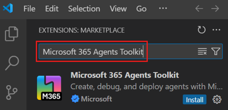
   *官方文档截图：在扩展市场搜索并安装。*

3. 装好后，左侧边栏会多出一个带 **M365** 字样的图标（下图左下角红框），点开就能看到 Agents Toolkit 的欢迎页。

   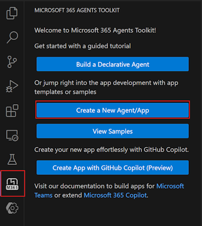
   *官方文档截图：左侧红框是 Agents Toolkit 图标；右侧红框是下一步要用的「Create a New Agent/App」按钮。*

> 💡 它会顺带装上 YAML 扩展，这是正常的。

---

## 4. 第二步：申请 API Key 并先测试 API

### 4.1 申请 NASA API Key

1. 打开 https://api.nasa.gov ，在 **Generate API Key** 表单里填名字和邮箱。
2. 提交后，key 会**立刻显示在页面上**，同时发到邮箱。它是一串 40 位左右的字母。
3. 免费额度：每小时 1000 次请求。

> ⚠️ **坑：`DEMO_KEY` 只适合试一两次。** NASA 允许用 `DEMO_KEY` 试用，但每个 IP 每小时只有约 30 次请求，测几次就会报 **429（请求过多）**。正式做项目请用自己的 key。

### 4.2 写配置之前，先确认 API 真的能用

**这是最重要的一条经验：先测 API，再写配置。** 不要相信网上教程里的接口清单一定还有效。

在浏览器地址栏里直接打开（把 `你的KEY` 换成自己的 key）：

```
https://api.nasa.gov/planetary/apod?date=2026-11-06&api_key=你的KEY
https://api.nasa.gov/neo/rest/v1/feed?start_date=2026-11-07&end_date=2026-11-08&api_key=你的KEY
https://api.nasa.gov/EPIC/api/natural/date/2026-11-03?api_key=你的KEY
```

能看到一大段 JSON 数据，就说明接口可用。我们实测的结果：

| 接口 | 用途 | 实测结果 |
|---|---|---|
| `/planetary/apod` | 每日天文图 | ✅ 能用，但图片字段有问题，见第 12 节 |
| `/neo/rest/v1/feed` | 近地小行星（最多 7 天） | ✅ 正常 |
| `/neo/rest/v1/neo/{id}` | 单颗小行星详情 | ✅ 正常 |
| `/EPIC/api/natural/date/{日期}` | DSCOVR 卫星拍的地球照片 | ✅ 正常 |
| `/mars-photos/...` | 火星车照片 | ❌ **已下线（返回 404）**，很多老教程还在用它 |

> ⚠️ **坑：今天的天文图可能还没发布。** APOD 按美国东部时间每天更新，北京时间白天去查「今天」，可能返回 **500 错误**。改查昨天就好，后面我们会把这个情况写进代理的指令里。

### 4.3 搞清楚 key 放在哪里

每家 API 传 key 的方式不同，这决定了 OpenAPI 文件怎么写：

| 方式 | 例子 | Copilot 是否支持 |
|---|---|---|
| 放在自定义请求头 | `X-Api-Key: 你的KEY`（NASA、美国国家公园局） | ✅ |
| 放在网址参数里 | `?key=你的KEY`（高德）、`?api_key=`（NASA 也支持） | ✅ |
| `Authorization: Bearer 你的KEY` | TMDB 等 | ✅ |
| 写在网址路径中间 | `/v6/你的KEY/latest/USD` | ❌ 不支持，换别的 API |

NASA 两种方式都支持，本教程用**请求头 `X-Api-Key`**。

---

## 5. 第三步：写 OpenAPI 描述文件

新建一个文件夹（比如 `C:\Projects\NASA\spec\`），在里面新建 `nasa-api.yaml`。**完整内容见[附录 B](#附录-b完整的-openapi-文件)，直接复制即可。** 下面讲解关键部分，方便你以后改成别的 API。

### 5.1 文件结构

```yaml
openapi: 3.0.0
info:
  title: NASA Open APIs            # 会显示在 Copilot 结果卡片的标题上
  description: ...
  version: 1.0.0
servers:
  - url: https://api.nasa.gov       # API 的公共前缀
paths:
  /planetary/apod:                  # 每个接口写一段
    get:
      operationId: getApod          # 接口名，必须唯一，Copilot 用它区分功能
      summary: Get the Astronomy Picture of the Day
      description: ...              # ★ 写清楚这个接口做什么，Copilot 靠它决定什么时候调用
      parameters:
        - name: date
          in: query
          description: Date of the picture in YYYY-MM-DD format.   # ★ 参数说明同样重要
          required: false
          schema:
            type: string
      responses:
        '200':
          ...
```

### 5.2 认证部分（必须写！）

文件末尾一定要有这一段，告诉 Toolkit 「这个 API 需要 key，放在 `X-Api-Key` 请求头里」：

```yaml
security:
  - ApiKeyAuth: []
components:
  securitySchemes:
    ApiKeyAuth:
      type: apiKey
      in: header        # 如果 key 放在网址参数里，就写 query
      name: X-Api-Key   # 请求头的名字，或者网址参数名（比如高德的 key）
```

> ⚠️ **坑：用 Postman 的「Generate Specification」生成的文件没有这一段，必须手动加上。** 原教程就特别提到了这一点。少了它，Toolkit 不会生成密钥相关的配置，部署后调用会返回 401 或 403。

### 5.3 写好描述的小技巧

- **`description` 用英文写，而且要具体**，比如「The date range can be at most 7 days」。Copilot 会照着它构造请求。
- 参数的格式（`YYYY-MM-DD`）、取值范围（1-10）、默认值都写进说明。
- **只放你测通过的接口。** 已经下线的接口放进去，代理就会报错。

---

## 6. 第四步：在 VS Code 里创建代理项目

1. 点左侧的 **Microsoft 365 Agents Toolkit** 图标。
2. 点 **Create a New Agent/App**。
3. 在顶部弹出的 **New Project** 列表中选 **Declarative Agent**。

   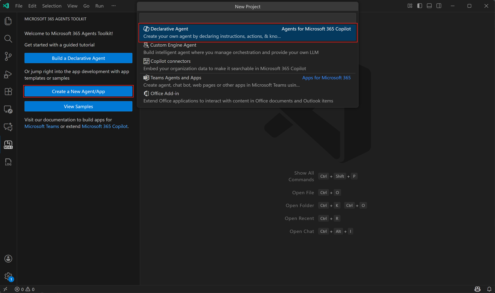
   *官方文档截图：点左边的「Create a New Agent/App」后，顶部弹出列表，选第一项「Declarative Agent」。*

4. 选 **Add an Action**。
5. 选 **Start with an OpenAPI Description Document**。
6. 选 **Browse**，找到第 5 步写好的 `nasa-api.yaml`。
7. 在接口列表里**勾选全部接口**，然后点 **OK**。

   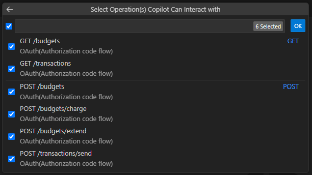
   *官方文档截图：示例里是别的 API，你看到的会是 `GET /planetary/apod`、`GET /neo/rest/v1/feed` 等 4 个接口。点左上角的复选框可以全选。*

8. 选项目存放的文件夹（可以选 **Default folder**，或者自己指定一个）。
9. 输入应用名称，比如 `SpaceExplorer`，按回车。
10. VS Code 会打开一个新窗口，里面就是生成好的项目。

> 💡 **另一种做法（原教程的方式）：** 先选 **No Action** 建一个空代理，再到 **DEVELOPMENT** 面板点 **Add Action** → **Start with an OpenAPI Description Document**，导入 YAML。两种方式效果一样。
>
> ⚠️ **坑：生成时出现「`additionalProperties` is not supported, and will be ignored」不用慌。** 这是 Toolkit 不支持某些数据结构的说明，不影响调用，只是那部分少了字段说明。

---

## 7. 第五步：认识项目里的文件

```
SpaceExplorer/
├─ appPackage/                       ← 打包上传到 Copilot 的所有内容
│  ├─ manifest.json                  ← 应用清单：名字、图标、简介
│  ├─ declarativeAgent.json          ← 代理定义：名字、描述、开场白、用哪个插件
│  ├─ instruction.txt                ← ★ 代理的「人设和规则」，决定它怎么回答
│  ├─ ai-plugin.json                 ← 插件定义：有哪些功能、认证方式、结果卡片
│  ├─ adaptiveCards/                 ← 结果卡片模板（第 12 节会改）
│  ├─ apiSpecificationFile/
│  │  ├─ openapi.yaml                ← Toolkit 处理后的版本，代理实际使用的是它
│  │  └─ openapi.yaml.original       ← 你原来的文件，原样保存
│  ├─ color.png / outline.png        ← 图标
├─ env/
│  ├─ .env.dev                       ← 环境变量（会提交到 git，不要放密钥）
│  └─ .env.dev.user                  ← 私密环境变量（不会提交到 git）
├─ m365agents.yml                    ← ★ 部署流程：Provision 时依次执行哪些步骤
└─ README.md
```

打开 `appPackage/ai-plugin.json`，能看到这段认证配置：

```json
"auth": {
    "type": "ApiKeyPluginVault",
    "reference_id": "${{APIKEYAUTH_REGISTRATION_ID}}"
}
```

意思是：**key 不写在代码里**，而是存进微软的密钥库（Teams 开发者门户），代码里只保留一个注册编号。这个编号在 Provision 时自动生成。

---

## 8. 第六步：必须检查和修改的配置

### 8.1 ⚠️ 最大的坑：检查 `m365agents.yml` 里有没有 `apiKey/register`

打开 `m365agents.yml`，在 `provision:` 下面找 `apiKey/register`。**我们做了两个项目，生成的文件里都缺了这一步。** 缺了它，key 不会被注册，`APIKEYAUTH_REGISTRATION_ID` 也没有值，部署会失败。

如果没有，就在 `teamsApp/create` 那一段**后面**加上（注意缩进，YAML 对空格敏感）：

```yaml
provision:
  # Creates an app
  - uses: teamsApp/create
    with:
      name: SpaceExplorer${{APP_NAME_SUFFIX}}
    writeToEnvironmentFile:
      teamsAppId: TEAMS_APP_ID

  # ↓↓↓ 加这一段 ↓↓↓
  - uses: apiKey/register
    with:
      name: ApiKeyAuth
      appId: ${{TEAMS_APP_ID}}
      apiSpecPath: ./appPackage/apiSpecificationFile/openapi.yaml
    writeToEnvironmentFile:
      registrationId: APIKEYAUTH_REGISTRATION_ID
  # ↑↑↑ 加这一段 ↑↑↑

  # Build app package with latest env value
  - uses: teamsApp/zipAppPackage
  ...
```

说明：
- `name: ApiKeyAuth` 要和 OpenAPI 文件 `securitySchemes` 下的名字一致。
- 用 2 个空格缩进，**不要用 Tab**。

### 8.2 把代理范围改成「个人」

打开 `env/.env.dev`，把：

```
AGENT_SCOPE=shared
```

改成：

```
AGENT_SCOPE=personal
```

> ⚠️ **坑：** 「共享（shared）」范围的代理只要带了自定义 API，就要管理员审批才能部署。测试阶段用 `personal`，只有你自己能看到，不需要审批。

### 8.3 改名字和简介（可选，但建议改）

自动生成的名字和描述都很生硬（比如 `Short description for SpaceExplorer`），改成好懂的：

**`appPackage/manifest.json`：**
```json
"name": {
    "short": "Space Explorer${{APP_NAME_SUFFIX}}",
    "full": "Space Explorer"
},
"description": {
    "short": "Explore space with NASA open data",
    "full": "Daily astronomy pictures, near-Earth asteroids and images of Earth from space, powered by NASA open APIs."
},
```

同一个文件顶部还有 `developer`（开发者）信息，**也要记得改**：

```json
"developer": {
    "name": "My App, Inc.",              ← 改成你的名字或团队名
    "websiteUrl": "https://www.example.com",
    "privacyUrl": "https://www.example.com/privacy",
    "termsOfUseUrl": "https://www.example.com/termofuse"
},
```

> ⚠️ **坑：** 不改的话，Copilot 里代理名字下面会显示「由 My App, Inc. 创建」（见第 11 节的截图）。三个网址在测试阶段可以保持示例值，正式发布前要换成真实地址。

**`appPackage/declarativeAgent.json`：** 修改 `name`、`description` 和 `conversation_starters`（开场白按钮）：
```json
"name": "Space Explorer",
"conversation_starters": [
    { "text": "Show me today's astronomy picture of the day" },
    { "text": "Are any hazardous asteroids passing Earth this week?" },
    { "text": "Show me a photo of Earth from space taken last week" }
],
```

> 💡 部署后，Copilot 里显示的名字会自动加上后缀 `dev`（比如 `Space Explorerdev`），这是 `APP_NAME_SUFFIX` 加的，用来区分开发版。

### 8.4 写好代理指令 `instruction.txt`（决定回答质量）

默认指令只有一句话，代理会答得很生硬。把它替换成具体规则：

```text
You are Space Explorer, a friendly guide to space using NASA open data. Answer in the language the user writes in.

- Pictures are displayed automatically in the result cards under your answer. Do not paste image URLs into your answer text; refer to "the image below" instead.
- Astronomy Picture of the Day: use getApod. Without a date it returns today's picture. For "random" requests use count (1-5). Give the date and a short summary of the explanation, and mention the copyright holder when present. If the returned title is "NASA Science", that is a known NASA API fault: do not use it as the title; describe the picture from its explanation, and tell the user the image can be viewed with the "Open NASA APOD" button. The earliest available date is 1995-06-16. Today's picture is published on U.S. Eastern time, so if the request without a date fails, call getApod again with yesterday's date and say which date you are showing.
- Asteroids: use getAsteroidFeed with a date range of at most 7 days (for "this week" use today and the next 6 days). Present the results as a table with name, close approach date, estimated diameter in meters (min-max), speed in km/s, miss distance in km and in lunar distances, and whether it is potentially hazardous. Highlight potentially hazardous asteroids and the closest one, and explain that "potentially hazardous" is a classification based on size and orbit, not a prediction of impact. Use getAsteroid with the asteroid id for details about a single asteroid.
- Earth images: use getEarthImages with a date. Images for the last day or two may not exist yet, so if the list is empty try an earlier date. Mention how many images were taken that day, the capture time (UTC) and the coordinates each image is centered on.
- Never show the "links" field or any URL containing api_key from the API responses.
- Only use data returned by the actions. If an action returns an error or no data, say so instead of guessing.
```

写指令的经验：
- **「Answer in the language the user writes in」**：用中文问就用中文答。
- **把 API 的已知毛病写进去**：比如「今天的图可能还没发布，失败就查昨天」。
- **指定输出格式**：比如「用表格列出」。
- ⚠️ **安全提醒：** NASA 小行星接口返回的 `links` 字段里**带着你的 key**，所以指令里要求「不要展示 `links` 字段」。

---

## 9. 第七步：登录 Microsoft 365 账号

1. 在 Agents Toolkit 侧边栏的 **ACCOUNTS** 面板，点 **Sign in to Microsoft 365**。

   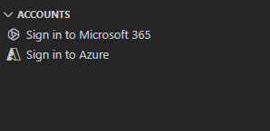
   *官方文档截图：点「Sign in to Microsoft 365」。「Sign in to Azure」本教程用不到。*

2. 浏览器会弹出登录页，用**有 Copilot 许可证的组织账号**登录。
3. 登录成功后，回到 VS Code，ACCOUNTS 面板里应该能看到你的账号，以及两个绿色对勾：
   - ✅ **Custom App Upload Enabled**（允许上传自定义应用）
   - ✅ **Copilot Access Enabled**（有 Copilot 权限）

   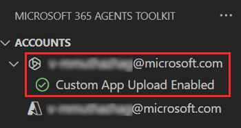
   *官方文档截图：登录成功后，账号下方出现绿色对勾。*

> ⚠️ **坑：这两项任何一个不是绿勾，下一步 Provision 都会失败。** 这时请换开发者租户，或者联系管理员在 Teams 管理中心开启「上传自定义应用」。管理员需要打开的就是下图这个开关（Teams 管理中心 → Teams 应用 → 设置策略 → 全局）：
>
> 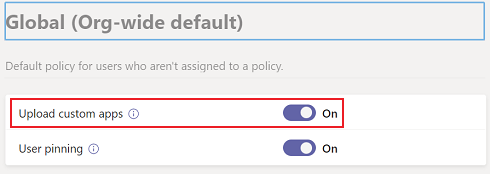
>
> *官方文档截图：「Upload custom apps」设为 On。*

---

## 10. 第八步：Provision（部署）

1. 在 Agents Toolkit 侧边栏的 **LIFECYCLE** 面板，点 **Provision**。

   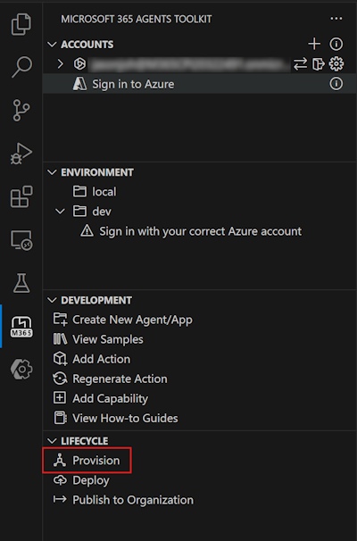
   *官方文档截图：最下面的 LIFECYCLE 里点「Provision」。顺便认识一下：DEVELOPMENT 里的「Add Action」用于给已有代理添加 API。*

2. 如果弹出选择环境的提示，选 **dev**。
3. 中途会弹出输入框，要求输入 API key：**粘贴你的 NASA key**，然后回车。

   
   *📷 待补截图（请自己截）：VS Code 顶部要求输入 API key 的输入框。截图前把 key 打码，或者在输入 key 之前截。*

4. 等待 1 到 3 分钟，右下角提示成功即可：

   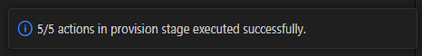
   *官方文档截图：右下角弹出「actions in provision stage executed successfully」。示例是 5/5；本教程多了 `apiKey/register`，所以是 6/6。*

   VS Code 底部的 **输出（Output）** 面板会显示 6 个步骤全部完成：

```
(√) teamsApp/create          创建应用
(√) apiKey/register          把 key 注册进密钥库
(√) teamsApp/zipAppPackage   打包
(√) teamsApp/validateAppPackage  校验
(√) teamsApp/update          更新应用
(√) copilotAgent/publish     发布到 Copilot
```

部署成功后，`env/.env.dev` 会自动多出几行，比如 `TEAMS_APP_ID`、`APIKEYAUTH_REGISTRATION_ID`、`M365_TITLE_ID`。**不要手动删改它们。**

### 💡 进阶：每次重新部署都不想再粘贴 key？

1. 在 `env/.env.dev.user` 里加一行（这个文件不会提交到 git，Toolkit 还会加密 `SECRET_` 开头的变量）：
   ```
   SECRET_NASA_API_KEY=你的KEY
   ```
2. 在 `m365agents.yml` 的 `apiKey/register` 段落里加一行 `primaryClientSecret`：
   ```yaml
   - uses: apiKey/register
     with:
       name: ApiKeyAuth
       appId: ${{TEAMS_APP_ID}}
       apiSpecPath: ./appPackage/apiSpecificationFile/openapi.yaml
       primaryClientSecret: ${{SECRET_NASA_API_KEY}}
   ```

> ⚠️ **绝对不要把 key 写进 `.env.dev`、`openapi.yaml` 或任何会提交到 git 的文件。** 如果 key 不小心泄露（比如发到群里、贴进截图），去 API 网站重新申请一个，改好 `.env.dev.user` 后再 Provision 一次。

---

## 11. 第九步：在 Copilot 里测试

**方法一：** 浏览器打开下面的地址，把 `M365_TITLE_ID` 换成 `env/.env.dev` 里同名变量的值，会直接进入这个代理：

```
https://m365.cloud.microsoft/chat/?titleId=M365_TITLE_ID的值
```

**方法二：** 打开 https://m365.cloud.microsoft/chat ，在左侧 **智能体（Agents）** 列表里找到 **Space Explorerdev**。

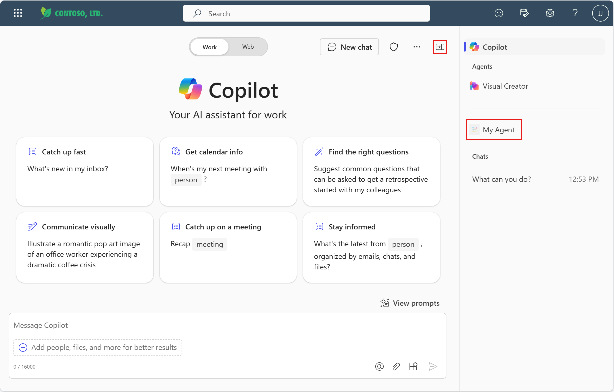
*官方文档截图：代理出现在智能体列表里（示例中叫 My Agent，你的叫 Space Explorerdev）。新版 Copilot 界面的列表在左侧边栏，名为「智能体和技能」，布局可能和截图略有不同。*

打开代理后，首页会显示代理名字和 8.3 节里设置的开场白按钮，点一下就能直接提问：

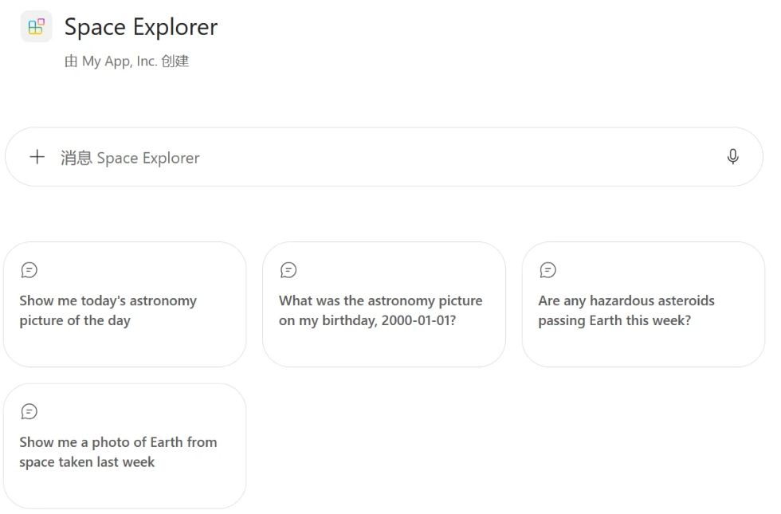
*本项目实际截图：Space Explorer 的首页。名字下面的「由 My App, Inc. 创建」就是 8.3 节提到的、没改的开发者名称。*

试着问：

- 「给我看昨天的天文图」
- 「这周有潜在危险的小行星吗？」
- 「给我看 11 月 3 日从太空拍的地球」

问小行星的效果如下：代理按 8.4 节指令的要求，先给出结论，再用表格列出名称、日期、直径、速度和距离，并说明「潜在危险」只是分类，不代表会撞击地球。

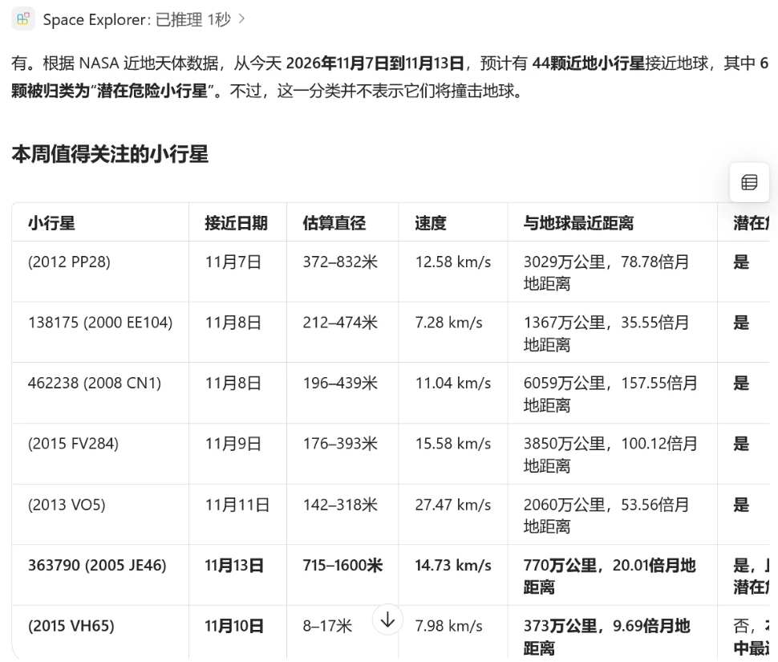
*本项目实际截图：问「这周有潜在危险的小行星吗？」得到的回答。表格可以左右滚动，右侧还有「潜在危险」一列。*

注意事项：
- 第一次调用 API 时，Copilot 可能会弹出确认框，询问是否允许访问 `api.nasa.gov`，点 **允许**。
- 刚部署完找不到代理？**等几分钟再刷新**，同步需要时间。
- 回答下方会出现一个标着 **NASA Open APIs** 的卡片，里面是接口返回的原始数据。看到它，说明 API 调用成功了。

---

## 12. 第十步：让图片在 Copilot 里显示出来

### 12.1 问题：回答里只有一串图片网址，没有图

我们第一次测试时，代理回复了 `https://epic.gsfc.nasa.gov/.../xxx.png` 这样一串网址，但没有显示图片。

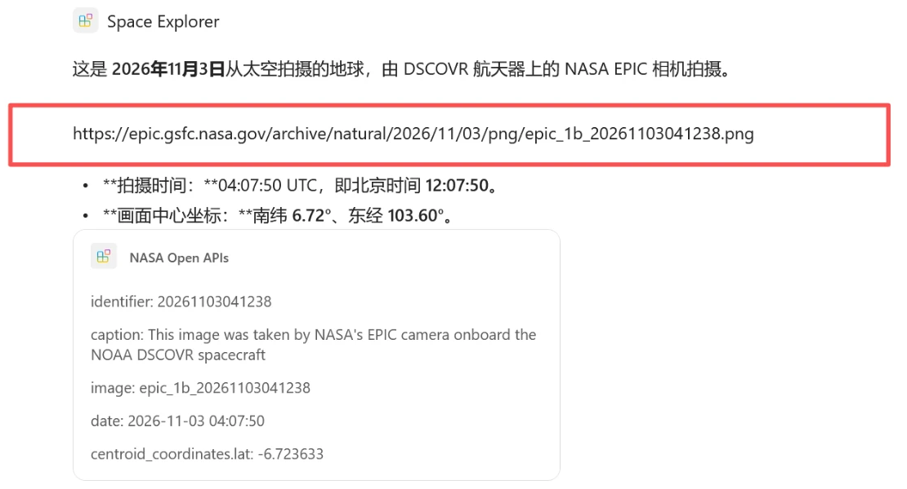
*本项目实际截图（修改前）：红框里的网址没有被渲染成图片；下方「NASA Open APIs」卡片也只有几行原始字段。*

**原因：** Copilot **不会把回答文字里的图片网址渲染成图片**。只有结果卡片（自适应卡片 Adaptive Card）里的 `Image` 元素才会显示图片。而 Toolkit 自动生成的卡片只有几行文字，没有图片元素。

### 12.2 解决：改卡片模板

卡片模板放在 `appPackage/adaptiveCards/` 里。`ai-plugin.json` 中每个功能的 `static_template` 指定了用哪个模板。比如地球图用的是 `adaptiveCards/getEarthImages1.json`。

把 `getEarthImages1.json` 整个替换成：

```json
{
    "type": "AdaptiveCard",
    "$schema": "https://adaptivecards.io/schemas/adaptive-card.json",
    "version": "1.5",
    "body": [
        {
            "type": "TextBlock",
            "text": "${if(caption, caption, 'NASA EPIC image of Earth')}",
            "wrap": true,
            "weight": "Bolder"
        },
        {
            "type": "Image",
            "url": "${concat('https://epic.gsfc.nasa.gov/archive/natural/', replace(substring(date, 0, 10), '-', '/'), '/jpg/', image, '.jpg')}",
            "altText": "Earth from space, ${date} UTC",
            "size": "Stretch"
        },
        {
            "type": "FactSet",
            "facts": [
                { "title": "Captured (UTC)", "value": "${date}" },
                { "title": "Centered on", "value": "lat ${centroid_coordinates.lat}, lon ${centroid_coordinates.lon}" }
            ]
        }
    ],
    "actions": [
        {
            "type": "Action.OpenUrl",
            "title": "Open full-resolution image",
            "url": "${concat('https://epic.gsfc.nasa.gov/archive/natural/', replace(substring(date, 0, 10), '-', '/'), '/png/', image, '.png')}"
        }
    ]
}
```

看懂这个模板：
- `${字段名}` 会被替换成 API 返回的数据，比如 `${date}`。
- EPIC 接口只返回日期（`2026-11-03 04:07:50`）和文件名（`epic_1b_20261103041238`），不返回完整图片网址，所以用 `concat`、`replace`、`substring` 这几个函数把网址**拼**出来：
  `https://epic.gsfc.nasa.gov/archive/natural/2026/11/03/jpg/epic_1b_20261103041238.jpg`
- 卡片里用 **jpg 版本（约 220 KB）**，而不是 png 原图（约 3 MB），加载快很多；高清 png 放在按钮里。

### 12.3 顺手修一个配置

在 `ai-plugin.json` 里找到 `getEarthImages` 的 `response_semantics.properties`。如果有 `"url": "$.image"`，**删掉它**：`image` 只是文件名，不是网址，写在这里会生成一个打不开的链接。

### 12.4 ⚠️ 坑：每日天文图的图片显示不了，是 NASA 接口自己的问题

改完卡片后，我们发现天文图接口不管查哪天，返回的 `title` 都是「NASA Science」，`url` 都是 **NASA 的 logo**，只有解说文字是对的。这是 APOD 迁到新网站后，NASA 接口上游出的错，**我们这边修不了**。

应对办法：让卡片检测到 logo 时不显示错误的图，改为提示文字加「打开 NASA APOD」按钮，同时在指令里告诉代理忽略「NASA Science」这个标题（见 8.4）。这样 NASA 修好接口后，卡片会自动恢复显示真图。完整模板在项目的 `appPackage/adaptiveCards/getApod1.json` 里。

> **经验：** 卡片显示不对时，先用浏览器直接打开 API，看返回的数据本身对不对，再判断是卡片的问题还是 API 的问题。

改完卡片后，回到 **LIFECYCLE → Provision** 重新部署，然后**在 Copilot 里新开一个对话**测试。旧对话不会刷新卡片。


*📷 待补截图（请自己截）：修改后，问「给我看 11 月 3 日从太空拍的地球」，卡片里出现地球照片和「Open full-resolution image」按钮。截图时只截回答区域，不要带上左侧的聊天记录。*

---

## 13. 以后怎么修改和更新

| 你改了什么 | 需要做什么 |
|---|---|
| `instruction.txt`、卡片模板、名字、开场白 | 点 **Provision** 重新部署，然后在 Copilot 里**新开对话**测试 |
| 新增或删除 API 接口 | 修改 OpenAPI 文件，到 **DEVELOPMENT → Add Action** 重新导入；或者直接改 `appPackage/apiSpecificationFile/openapi.yaml` 和 `ai-plugin.json`，再 Provision |
| 换了 API key | 修改 `env/.env.dev.user`（如果用了第 10 节的进阶做法），或者重新 Provision 时粘贴新 key |
| 想发布给全公司 | **LIFECYCLE → Publish to Organization**，需要管理员在 Microsoft 365 管理中心审批 |

> 💡 重新 Provision 不会创建重复的应用，Toolkit 会提示「already exists, skipped creating」，然后直接更新。

---

## 14. 踩坑排错速查表

| 现象 | 原因 | 解决办法 |
|---|---|---|
| 浏览器打开 API 返回 **429** | `DEMO_KEY` 每小时额度用完了 | 用自己申请的 key |
| 打开 API 返回 **404 / No such app** | 接口已经下线（比如火星车照片） | 从 OpenAPI 文件里删掉这个接口 |
| 天文图返回 **500** | 今天的图还没发布（美国东部时间更新） | 查昨天；把这条规则写进指令 |
| 生成项目时报 **「Could not open the file at ...\Temp\...」** | 命令行里用了相对路径 | 改用**绝对路径**（比如 `C:\Projects\NASA\spec\nasa-api.yaml`） |
| 生成时提示 **`additionalProperties` is not supported** | Toolkit 不支持字典类型的数据结构 | 忽略即可，不影响调用 |
| 校验报 **Missing environment variables 'APIKEYAUTH_REGISTRATION_ID'** | Provision 前它本来就是空的；如果 Provision 后还报，说明缺 `apiKey/register` 步骤 | 按 8.1 补上 `apiKey/register` |
| Provision 报**无权上传 / 自定义应用被禁用** | 租户没开 Custom App Upload | 换开发者租户，或者找管理员开通 |
| 登录后看不到 **Copilot Access Enabled** | 账号没有 Copilot 许可证 | 换有许可证的账号 |
| Copilot 里找不到代理 | 同步延迟 | 等几分钟，刷新页面 |
| 代理调用 API 时报 **401 / 403** | OpenAPI 文件缺 `securitySchemes`，或者 key 填错了 | 检查 5.2 节；重新 Provision，填正确的 key |
| 回答里只有图片网址，没有图 | Copilot 不渲染文字里的图片 | 用卡片的 `Image` 元素（第 12 节） |
| 卡片里的图片是 NASA logo | NASA APOD 接口上游出错 | 卡片降级处理（12.4 节） |
| 改完配置，Copilot 里没变化 | 还在看旧对话 | 重新 Provision 后**新开对话** |
| npm 安装 CLI 时提示 **keytar 脚本被阻止** | 新版 npm 默认禁止安装脚本 | 见附录 A 的安装命令 |

---

## 附录 A：命令行（CLI）做法

不想点界面，也可以全程用命令行完成，适合批量操作或写脚本。

```bash
# 1. 安装 CLI（keytar 用于保存登录凭据，需要允许它的安装脚本）
npm install -g --allow-scripts=@microsoft/m365agentstoolkit-cli,@azure/msal-node-extensions,keytar @microsoft/m365agentstoolkit-cli
atk --version
```

```bash
# 2. 从 OpenAPI 文件生成项目（⚠️ 路径必须用绝对路径）
atk new -c declarative-agent --with-plugin yes --api-plugin-type api-spec --openapi-spec-location "C:\Projects\NASA\spec\nasa-api.yaml" --api-operation "GET /planetary/apod,GET /neo/rest/v1/feed,GET /neo/rest/v1/neo/{asteroid_id},GET /EPIC/api/natural/date/{date}" --api-auth api-key -n SpaceExplorer -f "C:\Projects\NASA" -i false
```

```bash
# 3. 校验清单（Provision 前注册编号还没生成，用临时占位值只检查格式）
APIKEYAUTH_REGISTRATION_ID=placeholder TEAMS_APP_ID=00000000-0000-0000-0000-000000000000 atk validate --manifest-file ./appPackage/manifest.json --env dev -i false
```

```bash
# 4. 登录 Microsoft 365（会打开浏览器）
atk auth login m365
```

```bash
# 5. 查看当前登录的账号
atk auth list
```

```bash
# 6. 部署（需要先按第 10 节的进阶做法配置好 primaryClientSecret，否则非交互模式下没法输入 key）
atk provision --env dev -i false
```

> 第 3 条命令中给环境变量赋值的写法适用于 Git Bash、Mac 和 Linux。PowerShell 中要先执行 `$env:APIKEYAUTH_REGISTRATION_ID="placeholder"`，再运行 atk。

---

## 附录 B：完整的 OpenAPI 文件

把下面的内容保存为 `nasa-api.yaml`：

```yaml
openapi: 3.0.0
info:
  title: NASA Open APIs
  description: Astronomy Picture of the Day, near-Earth asteroids and full-disc Earth images from NASA.
  version: 1.0.0
servers:
  - url: https://api.nasa.gov
paths:
  /planetary/apod:
    get:
      operationId: getApod
      summary: Get the Astronomy Picture of the Day
      description: Returns NASA's Astronomy Picture of the Day (image or video) with title and an explanation written by an astronomer. Use date for a specific day, start_date and end_date for a range, or count for random pictures.
      parameters:
        - name: date
          in: query
          description: Date of the picture in YYYY-MM-DD format. Defaults to today. Earliest date is 1995-06-16.
          required: false
          schema:
            type: string
        - name: start_date
          in: query
          description: Start of a date range in YYYY-MM-DD format. Cannot be used with date or count.
          required: false
          schema:
            type: string
        - name: end_date
          in: query
          description: End of a date range in YYYY-MM-DD format. Defaults to today.
          required: false
          schema:
            type: string
        - name: count
          in: query
          description: Return this many randomly chosen pictures (1-10). Cannot be used with date or a date range.
          required: false
          schema:
            type: integer
        - name: thumbs
          in: query
          description: Return a thumbnail URL when the picture of the day is a video.
          required: false
          schema:
            type: boolean
      responses:
        '200':
          description: One picture, or an array of pictures when a date range or count is used.
          content:
            application/json:
              schema:
                $ref: '#/components/schemas/Apod'
  /neo/rest/v1/feed:
    get:
      operationId: getAsteroidFeed
      summary: Get asteroids approaching Earth in a date range
      description: Returns near-Earth asteroids by their closest approach date to Earth, including size, speed, miss distance and whether they are potentially hazardous. The date range can be at most 7 days.
      parameters:
        - name: start_date
          in: query
          description: Start date in YYYY-MM-DD format.
          required: true
          schema:
            type: string
        - name: end_date
          in: query
          description: End date in YYYY-MM-DD format, at most 7 days after start_date. Defaults to 7 days after start_date.
          required: false
          schema:
            type: string
      responses:
        '200':
          description: Asteroids grouped by close approach date.
          content:
            application/json:
              schema:
                $ref: '#/components/schemas/AsteroidFeed'
  /neo/rest/v1/neo/{asteroid_id}:
    get:
      operationId: getAsteroid
      summary: Get details about one asteroid
      description: Returns details for a single asteroid by its NASA JPL small body id (the id field returned by getAsteroidFeed), including all of its past and future close approaches.
      parameters:
        - name: asteroid_id
          in: path
          description: Asteroid SPK-ID, for example 3542519.
          required: true
          schema:
            type: string
      responses:
        '200':
          description: Asteroid details.
          content:
            application/json:
              schema:
                $ref: '#/components/schemas/Asteroid'
  /EPIC/api/natural/date/{date}:
    get:
      operationId: getEarthImages
      summary: Get full-disc images of Earth for a date
      description: Returns metadata for natural-color images of the whole sunlit side of Earth taken by NASA's EPIC camera on the DSCOVR satellite on the given date.
      parameters:
        - name: date
          in: path
          description: Date in YYYY-MM-DD format. Recent dates may not have images yet; try a few days earlier.
          required: true
          schema:
            type: string
      responses:
        '200':
          description: List of images taken on that date.
          content:
            application/json:
              schema:
                type: array
                items:
                  $ref: '#/components/schemas/EpicImage'
security:
  - ApiKeyAuth: []
components:
  securitySchemes:
    ApiKeyAuth:
      type: apiKey
      in: header
      name: X-Api-Key
  schemas:
    Apod:
      type: object
      properties:
        date:
          type: string
        title:
          type: string
        explanation:
          type: string
        media_type:
          type: string
          description: image or video
        url:
          type: string
        hdurl:
          type: string
        thumbnail_url:
          type: string
        copyright:
          type: string
    Asteroid:
      type: object
      properties:
        id:
          type: string
        name:
          type: string
        nasa_jpl_url:
          type: string
        absolute_magnitude_h:
          type: number
        is_potentially_hazardous_asteroid:
          type: boolean
        estimated_diameter:
          type: object
          properties:
            meters:
              type: object
              properties:
                estimated_diameter_min:
                  type: number
                estimated_diameter_max:
                  type: number
        close_approach_data:
          type: array
          items:
            type: object
            properties:
              close_approach_date:
                type: string
              orbiting_body:
                type: string
              relative_velocity:
                type: object
                properties:
                  kilometers_per_second:
                    type: string
                  kilometers_per_hour:
                    type: string
              miss_distance:
                type: object
                properties:
                  kilometers:
                    type: string
                  lunar:
                    type: string
                    description: Miss distance in multiples of the Earth-Moon distance.
                  astronomical:
                    type: string
    AsteroidFeed:
      type: object
      properties:
        element_count:
          type: integer
        near_earth_objects:
          type: object
          description: Keys are dates (YYYY-MM-DD); each value is the list of asteroids making their closest approach that day.
          additionalProperties:
            type: array
            items:
              $ref: '#/components/schemas/Asteroid'
    EpicImage:
      type: object
      properties:
        identifier:
          type: string
        caption:
          type: string
        image:
          type: string
          description: Image file name without extension.
        date:
          type: string
          description: Capture time, YYYY-MM-DD HH:MM:SS (UTC).
        centroid_coordinates:
          type: object
          properties:
            lat:
              type: number
            lon:
              type: number
```

---

## 附录 C：换成别的 API 怎么做

整套流程完全通用，换 API 时只改这几处：

1. **申请对应服务的 key**，并且先在浏览器里测通。
2. **重写 OpenAPI 文件**：改 `servers.url`、`paths`，并按这家 API 的规则写 `securitySchemes`（key 放在请求头还是网址参数里）。
3. 重新 **Create a New Agent/App**，按第 8 节检查配置，然后 Provision。

几个适合练手的 API：

| API | 能做什么 | `securitySchemes` 怎么写 |
|---|---|---|
| 高德 Web 服务（restapi.amap.com/v3） | 天气、地点搜索、路线规划 | `in: query`，`name: key`。⚠️ 申请时类型要选「Web服务」；不要设 IP 白名单，因为调用来自微软云端 |
| 和风天气 QWeather | 中文天气、生活指数、灾害预警 | `in: query`，`name: key` |
| OpenWeatherMap | 全球天气 | `in: query`，`name: appid` |
| TMDB | 电影和剧集搜索 | `type: http`，`scheme: bearer` |
| 美国国家公园局（developer.nps.gov/api/v1） | 公园、营地信息（原教程用的就是它） | `in: header`，`name: X-Api-Key` |

> 💡 原教程参考：Matthew Devaney，《M365 Agents Toolkit: Add A Custom API To An Agent》。https://www.matthewdevaney.com/m365-agents-toolkit-add-a-custom-api-to-an-agent/
>
> 官方文档：https://learn.microsoft.com/microsoft-365/copilot/extensibility/build-declarative-agents
>
> 截图出处：标注「官方文档截图」的图片来自 Microsoft Learn 的以下页面，按 CC BY 4.0 许可使用：
> [安装 Agents Toolkit](https://learn.microsoft.com/microsoftteams/platform/toolkit/install-teams-toolkit)、
> [Agents Toolkit 前提条件](https://learn.microsoft.com/microsoftteams/platform/toolkit/tools-prerequisites)、
> [创建声明式代理](https://learn.microsoft.com/microsoft-365/copilot/extensibility/build-declarative-agents)、
> [从现有 API 构建插件](https://learn.microsoft.com/microsoft-365/copilot/extensibility/build-api-plugins-existing-api)。
